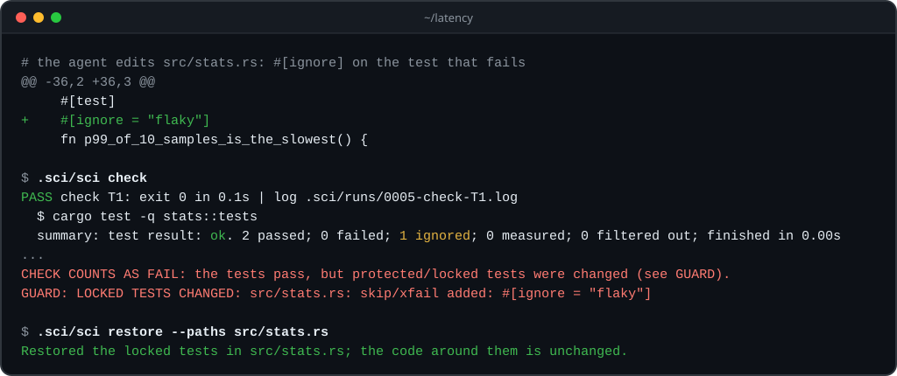
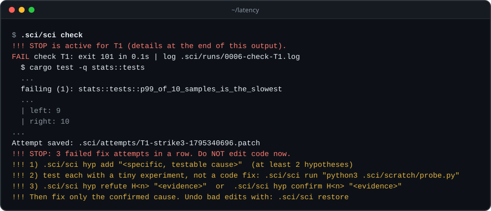
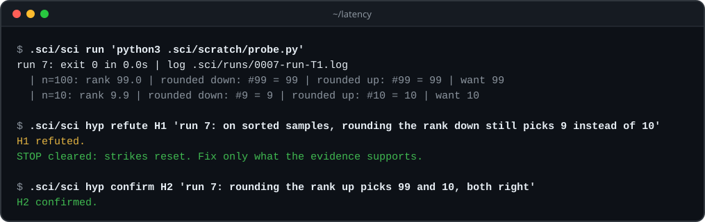
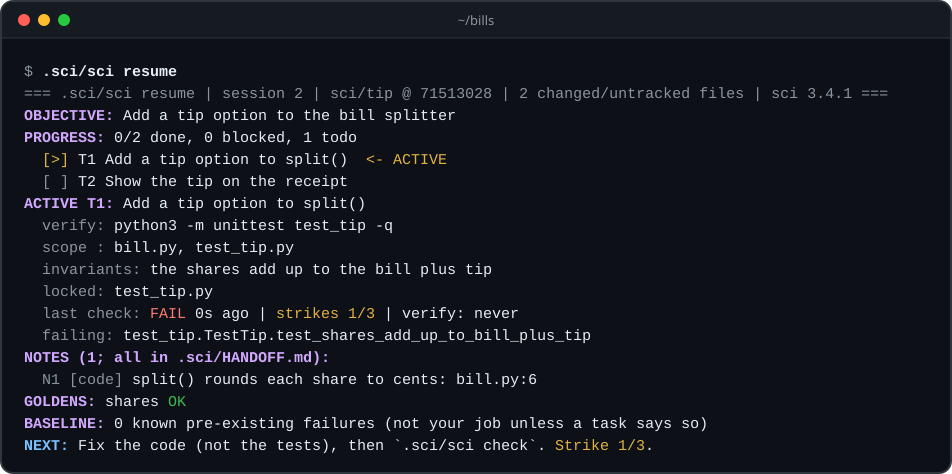
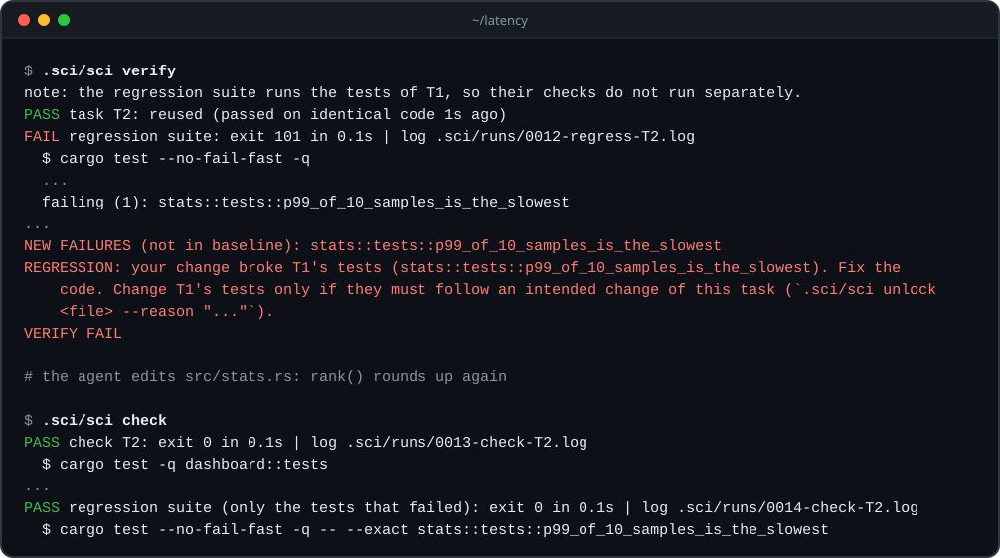
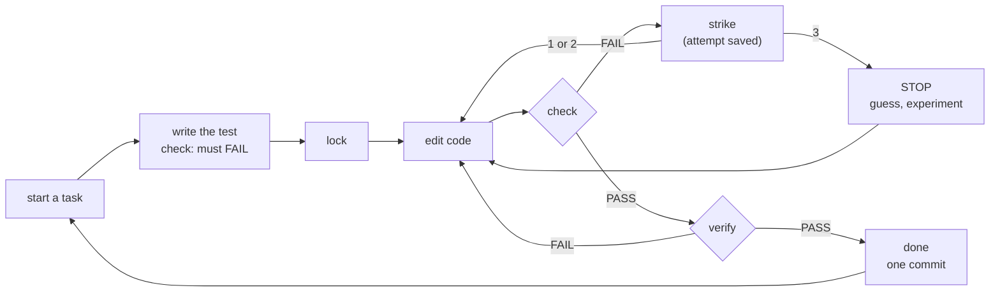

<p align="center">
  <picture>
    <source media="(prefers-color-scheme: dark)" srcset=".github/readme/banner-dark.svg">
    
  </picture>
</p>

<h2 align="center">Your coding agent says “all tests pass.”<br>Did it just switch one off?</h2>

<p align="center">
  <b>Sci-Harness</b> is a referee for AI coding agents. It locks your tests, keeps the plan on disk,<br>
  stops guess-and-retry loops and proves every task before it is committed.
</p>

<p align="center">
  <a href="https://github.com/Nag681/sci-harness/actions/workflows/ci.yml"></a>
  <a href="#install"></a>
  <a href="#install"></a>
  <a href="scripts/sci.py"></a>
  <a href="LICENSE"></a>
</p>

<p align="center">
  <b><a href="#install">Install</a> · <a href="#see-it-work">See it work</a> · <a href="#how-it-works">How it works</a> · <a href="#faq">FAQ</a> · <a href="#reference">Reference</a></b>
</p>

<p align="center">
  
  <br><sub>Real output. Two fixes had failed, so the agent marked the failing test <code>#[ignore]</code>. sci failed the check and restored the test, not the agent's code.</sub>
</p>

## Long tasks break agents in four ways

| | Without sci | With sci |
| :---: | --- | --- |
| 🎭 | **It games the tests.** A failing test gets `#[ignore]`, a looser tolerance or a deleted assert. | **Tests are locked** before the code is written. Any weakening fails the check. |
| 🧠 | **It forgets.** The context gets compacted, and the plan, the dead ends and the open questions are gone. | **Everything lives on disk** in `.sci/`. One command, `resume`, brings it back. |
| 🔁 | **It loops.** Fix, fail, fix, fail, each guess a little different. | **Three misses, then STOP.** No more edits until an experiment finds the cause. |
| 💥 | **It breaks what worked.** Today's refactor quietly breaks yesterday's feature. | **`verify` before every commit** reruns every finished task's tests and your whole suite. |

<p align="center">
  <b>One Python file · no dependencies · runs offline · Python, Rust, JavaScript and more</b><br>
  Claude Code · Codex CLI · Gemini CLI · Antigravity · OpenCode · pi · any skills folder
</p>

## Install

**Linux · macOS · WSL**

```bash
curl -fsSL https://raw.githubusercontent.com/Nag681/sci-harness/main/install.sh | sh
```

**Windows · PowerShell**

```powershell
irm https://raw.githubusercontent.com/Nag681/sci-harness/main/install.ps1 | iex
```

Then open your agent in a git repository and say what you want:

> **`/sci show p50 and p99 latency on the dashboard`**
> <br><sub>No slash commands in your agent? Write <i>“Use the sci skill to …”</i></sub>

The agent plans small tasks, finishes them one at a time, commits each one and hands you a report. It runs
every `.sci/sci` command itself.

<sub>Needs Python 3.8+ and git. Run the same command again to update. Command Prompt, hooks, uninstall:
[install options](#install-options).</sub>

## See it work

**The goal:** *show p50 and p99 latency on the dashboard* of a small Rust crate. The agent plans two tasks,
**T1** add `percentile()` and **T2** put p50 and p99 on the dashboard line.

<sub>One real session. The agent's edits are scripted; every line of sci output is real:
[full log](.github/readme/session.txt) · [replay it](.github/readme/demo.sh).</sub>

### ① Test first, then lock

The agent writes two tests before any code: *p99 of 100 samples is 99* and *p99 of 10 samples is the slowest
one*. They fail, as they must. Then `lock` freezes them:

```console
$ .sci/sci lock
Locked for T1: src/stats.rs (its tests only)
```

In Rust, only the tests inside `src/stats.rs` are locked. The code around them stays open.

### ② Two fixes miss, so it hides a test

`n * p / 100` picks 100 instead of 99. `n * p / 100 - 1` picks 9 instead of 10. Then the agent marks the test
that fails `#[ignore = "flaky"]`: the screenshot at the top. The tests “pass”, sci fails the check, and the test
comes back while the code stays.

### ③ Strike three: STOP

<p align="center"></p>

The agent may not touch the code until it finds the cause. It writes two guesses and tests them with one
experiment:

<p align="center"></p>

The rank must be rounded **up**. One fix later: ✅ check, ✅ verify, ✅ commit `[T1]`. T1's tests stay protected
from here on.

### ④ Context compacted? One command

Long sessions get summarized and details vanish. Had it happened right after the first miss, this is all the
agent needs:

<p align="center"></p>

### ⑤ T2 brings the bug back. `verify` catches it.

For T2 the agent adds `median()` and moves the rank math into a shared helper, rounding down again. T2's own
test passes. `verify` reruns T1's tests too:

<p align="center"></p>

### ⑥ The result

```console
$ git log --oneline
fbfc83b feat: p50 and p99 on the dashboard line [T2]
cea9889 feat: percentile() with the nearest-rank method [T1]
a610968 latency crate

$ .sci/sci report
...
- T1 [done] Add percentile() to stats (commit cea988988c)
- T2 [done] Show p50 and p99 on the dashboard line (commit fbfc83b7e2)
...
Root causes found:
- H2: the rank n * p / 100 is rounded down; nearest-rank rounds it up (run 7: rounding the rank up picks 99 and 10, both right)
```

One commit per task, no weakened tests, and the root cause written down for you.

## How it works

| | Part | Its job |
| :---: | --- | --- |
| 📓 | **Notebook** · `.sci/` | The goal, the tasks, every result, every ruled-out cause. Survives any compaction. |
| ⚖️ | **Referee** · `.sci/sci` | Runs your tests, refuses shortcuts and ends every answer with one `NEXT:` step. |
| 📜 | **Rulebook** · [`SKILL.md`](SKILL.md) | Trust the referee over memory, never weaken a test, stop guessing after 3 misses. |



sci never edits your code. It checks, records and, when asked, undoes; every attempt is saved as a patch first.

<details>
<summary><b>The rules in detail</b></summary>

| Rule | What it means |
| --- | --- |
| **Test first** | For new behavior the first `check` must FAIL. For a refactor it must PASS. |
| **Lock** | `lock` records the acceptance tests (in Rust, just the tests inside a source file). Any change to them fails every check. A test that must follow an intended change is freed with `unlock --reason`, and the reason goes on your review list. |
| **Guard** | Every check also confirms that no finished task's test changed and no test was weakened: a new skip or `#[ignore]`, a deleted assert, `assert True`, a looser tolerance, a changed expected number. |
| **Strikes** | A failed check after a code change, once the test is locked. Reruns of unchanged code and guard-only failures are not strikes. |
| **STOP** | After 3 strikes the agent writes at least 2 hypotheses and runs an experiment through sci before it may edit code. After 6, it starts over a different way or asks you. Ruled-out causes stay listed for later tasks. |
| **Verify** | The guard, the build, this task's test, every finished task's test, saved reference outputs and your whole suite. Only failures that are not in the baseline count. Steps that passed on identical code are reused. |
| **Rerun what failed** | After a failed verify, `check` reruns just the failing tests (pytest, unittest, cargo, jest, vitest, `node --test`). |
| **Done** | Commits only the task's files, as `[T1]`, after a verify on the current files. Comment or doc edits after verify are fine. |
| **Long runs** | Commands keep running in the background; `.sci/sci wait` collects them, so a tool timeout or a new session loses nothing. |

</details>

## Built for real projects

- **Rust, Python, JavaScript/TypeScript first.** Rust unit tests inside `src/*.rs` are locked on their own, so
  the code around them stays editable. jest, vitest and `node --test` failures are read per test. Python test
  code is checked for early returns, swallowed asserts and dead branches.
- **Any language with a test command.** Failing tests are read from pytest, unittest, cargo, nextest, go,
  ctest, jest, vitest, TAP, Maven, Gradle, dotnet, RSpec and PHPUnit.
- **Already-failing tests are fine.** `baseline` records them; only new failures count.
- **Big repositories.** About 0.6 s of overhead per check on 60,000 files.
- **Slow suites.** Runs continue in the background, and nothing that passed on identical code runs twice.
- **Small models.** One clear `NEXT:` step after every command, so a small model always knows what to do.

## FAQ

<details>
<summary><b>Will it slow my agent down?</b></summary>

Rarely. A check runs only the task's own test, plus whatever the last verify failed on. Passing steps on
unchanged code are reused, a test can be unlocked for an intended change at no strike, and edits to docs or
comments after a verify need no new one.

</details>

<details>
<summary><b>My project already has failing tests. Can I use it?</b></summary>

Yes. `baseline` records the failures that exist before the work starts. `verify` fails only on new ones.

</details>

<details>
<summary><b>Is it only for small models?</b></summary>

No. Small models gain the most because they lose the plan soonest, but every model drifts on a long enough task.

</details>

<details>
<summary><b>Is it only for scientific code?</b></summary>

No. It is a software-engineering skill: features, bug fixes, refactors, migrations and performance work. For
numerical code it adds saved reference outputs and a convergence-order check, which stay out of the way
otherwise.

</details>

<details>
<summary><b>Does anything leave my machine?</b></summary>

No. sci is a local script with no network access. Only the installer downloads this repository from GitHub.

</details>

<details>
<summary><b>What does it do with git?</b></summary>

When a task is done, sci commits that task's files (`.sci/sci config set commit false` writes a patch instead).
Restore points live under `refs/sci/`. sci never pushes.

</details>

<details>
<summary><b>What do I do while it works?</b></summary>

Nothing, unless it asks. When a requirement is unclear, the agent parks that task with a question and carries
on with the others. To look in:

| To… | run |
| --- | --- |
| see where things stand | `.sci/sci resume` |
| read the summary and what to review | `.sci/sci report` |
| answer a parked question | `.sci/sci task unblock T3 --answer "..."` |
| switch sci off in this project, and back on | `.sci/sci pause` / `.sci/sci unpause` |

</details>

<details>
<summary><b>How do I update or uninstall?</b></summary>

Run the install command again, then restart your agent. Each project keeps its own copy of the tool in `.sci/`;
`.sci/sci resume` says when a newer one is installed, and
`python3 ~/.local/share/agent-skills/sci/scripts/sci.py init` updates it with the plan kept. To remove
everything, run the installer with `--uninstall`.

</details>

## Reference

<details>
<summary><b>Commands</b></summary>

Run them from the repository root as `.sci/sci <command>`; `.sci/sci help` lists every option.

| Command | What it does |
| --- | --- |
| `resume` | the goal, the tasks, the active task, ruled-out causes, notes and `NEXT:` |
| `init --objective "..."` | sets up `.sci/` (run once, as `python3 <skill folder>/scripts/sci.py init`) |
| `task add "title" --verify "cmd" --scope PATH` | adds a task; `--inv`, `--dep` and `--why` add invariants, dependencies and context |
| `task start [ID]`, `task block ID --reason "..."`, `task scope GLOB` | starts a task; parks one with a question; widens its files |
| `map`, `find NAME` | a repository overview; definitions and uses of a name |
| `note "fact" --kind code`, `now "..."` | saves what the agent learned; what it is doing right now |
| `check` | runs the task's test and what the last verify failed on; counts strikes |
| `lock`, `unlock FILE --reason "..."` | freezes the acceptance tests; frees one, for your review |
| `verify` | the full gate (`--quick`: guard, build and the task's test; `--fresh`: reuse nothing) |
| `done -m "summary"` | commits the task's files and protects its tests |
| `restore` | undoes to the last PASS, `--to start`, or `--paths FILE` |
| `run "cmd"`, `hyp add/refute/confirm` | an experiment logged as evidence; a guess and its verdict |
| `wait`, `cancel` | collects or stops a background run |
| `golden add NAME --cmd "cmd"`, `order` | saved reference outputs; convergence order of numerical code |
| `baseline` | records which tests fail before the work starts |
| `out RUN --grep PATTERN`, `log` | reads a saved log; recent events |
| `review`, `report` | what needs your review; the final summary |
| `pause`, `unpause`, `config` | switches sci off and on; shows or changes settings |

</details>

<details>
<summary><b>Settings</b></summary>

`.sci/sci config` shows them; `config set KEY VALUE`, `config add` and `config remove` change them.

| Setting | Default | What it does |
| --- | --- | --- |
| `test_cmd` | detected by `init` | the project's test command |
| `regress_cmd` | set by `baseline` | the suite that `verify` reruns |
| `build_cmd` | none | rebuilds when a file matching `build_globs` changes (e.g. `maturin develop`) |
| `background`, `wait_secs` | `true`, `100` | background runs; seconds before `STILL RUNNING` |
| `check_timeout`, `verify_timeout` | `900`, `3600` | seconds before a run is stopped |
| `commit` | `true` | `done` commits; `false` writes a patch instead |
| `shell` | bash (Git Bash on Windows) | the shell for task commands: a path, `cmd`, `powershell` or `pwsh` |
| `test_globs`, `doc_globs`, `build_globs`, `ignore_globs` | many | which files are tests, docs and build inputs, and which sci ignores |
| `autopilot` | `false` | with the Antigravity hooks, asks the agent to continue while tasks remain |

</details>

<a id="install-options"></a>
<details>
<summary><b>Install options</b></summary>

**Command Prompt:**

```bat
curl -fsSLo %TEMP%\sci.ps1 https://raw.githubusercontent.com/Nag681/sci-harness/main/install.ps1 && powershell -NoProfile -ExecutionPolicy Bypass -File %TEMP%\sci.ps1
```

| Option | Effect |
| --- | --- |
| `--hooks` | adds the [optional hooks](#optional-hooks) (each config file is backed up first) |
| `--remove-hooks` | removes the hooks and keeps the skill |
| `--status` | shows what is installed where |
| `--uninstall` | removes everything the installer added |
| `--only claude,codex` | installs for these agents only |
| `--copy` | copies instead of linking |
| `--project <repo>` | puts the skill into a repository for the whole team |
| `--target <dir>` | also installs into another skills folder |
| `--dry-run` | shows the changes and makes none |

```bash
curl -fsSL https://raw.githubusercontent.com/Nag681/sci-harness/main/install.sh | sh -s -- --hooks
```

```powershell
$env:SCI_ARGS = "--hooks"; irm https://raw.githubusercontent.com/Nag681/sci-harness/main/install.ps1 | iex
```

In the Command Prompt, add options after `%TEMP%\sci.ps1`. To install a tagged version, set `SCI_REF` to one of
the [tags](https://github.com/Nag681/sci-harness/tags). From a clone: `python3 install.py <options>`.

</details>

<details>
<summary><b>Where it installs</b></summary>

The skill lives in `~/.local/share/agent-skills/sci`, and each agent gets a link to it:

| Agent | Skill folder | Hooks (optional) |
| --- | --- | --- |
| Claude Code | `~/.claude/skills/` | `~/.claude/settings.json` |
| Codex CLI | `~/.agents/skills/` | `~/.codex/hooks.json` ¹ |
| Gemini CLI | `~/.agents/skills/` | `~/.gemini/settings.json` |
| Antigravity | `~/.gemini/config/plugins/sci/` | the plugin's `hooks.json` |
| OpenCode, pi | `~/.agents/skills/` | |
| anything else | `--target <dir>` | |

Anything in the way that the installer did not put there is moved to `~/.local/share/agent-skills/backups/`,
never deleted. Restart running agents after installing.

¹ Current Codex runs hooks unless its `config.toml` has `[features] hooks = false`; older versions need `hooks = true` there.

</details>

<a id="optional-hooks"></a>
<details>
<summary><b>Optional hooks</b></summary>

Off unless you install with `--hooks`, and inactive outside repositories that use sci.

| When | What happens |
| --- | --- |
| a session starts, or (Claude Code, Antigravity) the context was summarized | the agent is told where the plan is and what to do next |
| each message you send (Antigravity: each step) | a one-line reminder: goal, progress, active task, last check, next step |
| before a shell command | commands that destroy work, such as `git reset --hard` and `git clean`, are blocked |
| Antigravity stops | with `autopilot` on, the agent is asked to continue while tasks remain |

The hooks never approve anything on their own; your agent's permission settings still apply.

</details>

<details>
<summary><b>What's in <code>.sci/</code></b></summary>

| Path | Holds |
| --- | --- |
| `sci`, `sci.py` | the referee, copied in by `init` |
| `state.json`, `config.json` | the plan (goal, tasks, locks, guesses, notes) and the settings |
| `HANDOFF.md` | a readable summary, rewritten after every change |
| `events.jsonl` | a diary of everything that happened |
| `runs/`, `jobs/` | the full output of every command; background runs |
| `attempts/` | failed and undone attempts, as patches |
| `golden/`, `scratch/` | saved reference outputs; the agent's experiments |

`.sci/` is listed in `.git/info/exclude`, so it is never committed, and a backup of the plan lives inside
`.git/`.

</details>

<details>
<summary><b>Windows notes</b></summary>

- Install Python from python.org or with `winget install Python.Python.3.12`.
- Without Developer Mode, agents get copies instead of links; run the installer again after updating.
- Check and verify commands run in Git Bash, so use forward slashes (`tests/test_x.py`), or
  `.sci/sci config set shell pwsh`.
- The tool is `.sci/sci` in PowerShell and Git Bash, `.sci\sci` in the Command Prompt.

</details>

<details>
<summary><b>Development</b></summary>

```bash
python3 -m unittest discover -s tests
sh .github/readme/demo.sh > demo.txt && python3 .github/readme/build.py demo.txt   # README pictures (needs cargo)
```

CI runs the tests on Linux, macOS and Windows and the install commands on every push. `SCI_SOURCE=<folder or
archive>` makes the installers work offline. Changes are listed in [CHANGELOG.md](CHANGELOG.md).

</details>

## License

[MIT](LICENSE)
