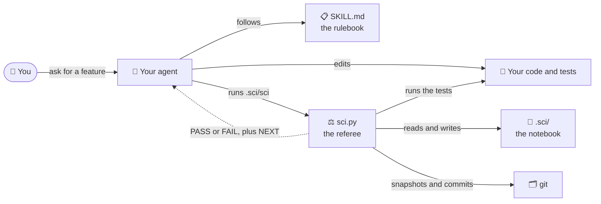
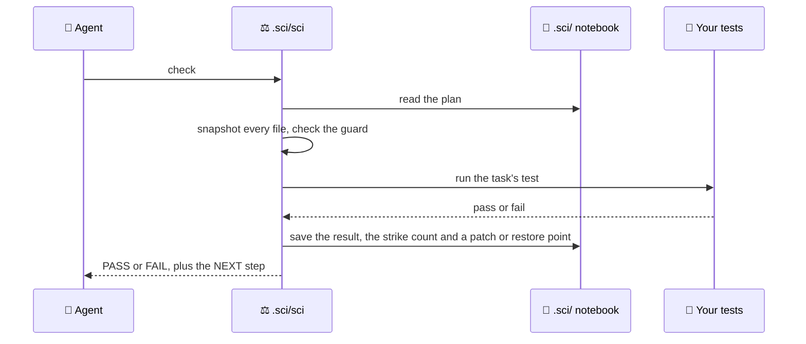
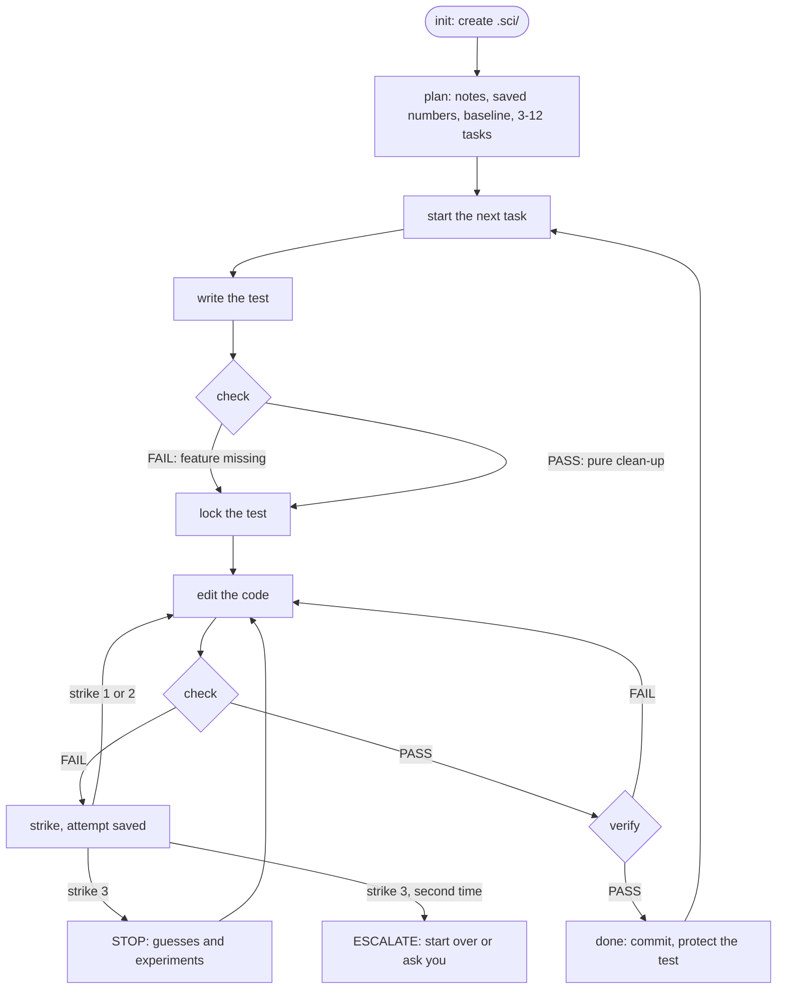

<div align="center">

# Sci-Harness

**Keeps small, inexpensive coding models on track in long scientific coding tasks.**

[](https://github.com/Nag681/sci-harness/actions/workflows/ci.yml)
[](#install)
[](#install)
[](scripts/sci.py)
[](LICENSE)

[Install](#install) · [How to use it](#how-to-use-it) · [Example](#example-splitting-a-bill) · [How it works](#how-it-works) · [FAQ](#faq)

</div>

<br>

AI coding agents forget the plan when their memory fills up. They "fix" a failing test by making the test easier,
and when they're stuck they keep guessing. Small models do this the most.

Sci-Harness gives your agent an [Agent Skill](https://agentskills.io) called **`sci`**. It brings a notebook that
survives memory loss, a referee that runs the tests and refuses shortcuts, and a short rulebook. It works with
**Claude Code, Codex CLI, Gemini CLI, Antigravity, OpenCode and pi**.

## Install

**Linux · macOS · WSL**

```bash
curl -fsSL https://raw.githubusercontent.com/Nag681/sci-harness/main/install.sh | sh
```

**Windows · PowerShell**

```powershell
irm https://raw.githubusercontent.com/Nag681/sci-harness/main/install.ps1 | iex
```

**Windows · Command Prompt**

```bat
curl -fsSLo %TEMP%\sci.ps1 https://raw.githubusercontent.com/Nag681/sci-harness/main/install.ps1 && powershell -NoProfile -ExecutionPolicy Bypass -File %TEMP%\sci.ps1
```

> [!NOTE]
> Needs **Python 3.8+** and **git**. The installer finds your agents and links the skill into each one.
> Run the same command again to update. For flags such as `--hooks` or `--uninstall`, see
> [install options](#install-options).

## How to use it

1. **Install it** with the command above, then restart your agent.
2. **Open your agent in your project folder.** The project has to be a git repository. If it isn't one yet, run
   `git init && git add -A && git commit -m start` first.
3. **Say what you want and name the skill.** In Claude Code, type `/sci add a tip option to the bill splitter`.
   In any agent, you can write *"Use the sci skill to add a tip option to the bill splitter."*
4. **Let it work.** The agent plans small tasks and finishes them one at a time. Each finished task becomes its
   own git commit, so you can always see what changed and why.
5. **Answer its questions.** When something is unclear (units, rules, what you meant), the agent parks that task,
   carries on with the others and asks you.
6. **Read the report at the end.** It lists what was done, the causes of bugs it found and everything you should
   look over.

> [!TIP]
> You don't need to learn any `.sci/sci` commands, because the agent runs them itself. These are for peeking in:
>
> | You want to… | Run |
> | --- | --- |
> | see where things stand and what comes next | `.sci/sci resume` |
> | get the summary and the list of things to look over | `.sci/sci report` |
> | see only what needs your review | `.sci/sci review` |
> | answer a question the agent parked | `.sci/sci task unblock T3 --answer "..."` |
> | pause the harness in this project, and resume it | `.sci/sci pause` / `.sci/sci unpause` |

## Example: splitting a bill

Say you have a tiny app that splits a restaurant bill between friends, and you type:

> `/sci add a tip option to the bill splitter`

Everything quoted below is real sci output from this exact example (sometimes shortened).

### 1. A plan before any code

- **Notes:** the agent writes down what it learns, such as *"split() rounds each share to cents"*.
- **Saved numbers:** it records what the app computes today. `split(100, 3)` gives `[33.33, 33.33, 33.33]`.
  If a later change moves these numbers, sci notices.
- **Baseline:** it runs your tests once. From then on, only *new* failures count against the agent.
- **Tasks:** it splits the job into small tasks. Each task gets a test that proves it's done and a list of files
  it may change:
  - **T1** *Add a tip option to split()*. It may change `bill.py` and `test_tip.py`.
  - **T2** *Show the tip on the receipt*. It waits for T1.

### 2. Task T1, step by step

| | The agent… | sci says… |
| :---: | --- | --- |
| 1 | writes the test first: *"$100 plus a 15% tip, split 3 ways, must add up to $115.00"*, then runs `check` | ❌ **FAIL**: `split()` has no tip yet. That's the point: a test that passes before the work starts proves nothing. |
| 2 | runs `lock` | 🔒 The test is frozen. If anyone edits it from now on, every check fails. The agent can't make the exam easier. |
| 3 | rounds each share to cents: 3 × $38.33 | ❌ $114.99, a cent short. **Strike 1.** The attempt is saved, so no work is ever lost. |
| 4 | rounds up instead: 3 × $38.34 | ❌ $115.02. **Strike 2.** |
| 5 | switches to exact decimal math | ❌ $114.99 again. **Strike 3: 🛑 STOP.** No more code edits until the cause is found. |
| 6 | writes two guesses. **H1:** computer math is inexact. **H2:** rounding every share loses the leftover cent. | Test them with experiments, not fixes. |
| 7 | runs a 5-line experiment: even exact math gives $114.99 | H1 is ruled out and H2 is confirmed. The STOP lifts. |
| 8 | gives the leftover cent to the first person: $38.34 + $38.33 + $38.33 | ✅ **PASS** |
| 9 | runs `verify` to check everything | ⚠️ The saved numbers moved: `split(100, 3)` now starts with 33.34 instead of 33.33. |
| 10 | explains why: *"the old shares lost a cent (3 × 33.33 = 99.99)"* | The new numbers are saved, and the change goes on **your review list**. |
| 11 | runs `verify` again | ✅ The test, the saved numbers and the whole test suite all **PASS**. |
| 12 | runs `done` | 📦 Only `bill.py` and `test_tip.py` are committed, as `[T1]`. From now on, the test is protected. |

<details>
<summary><b>Real output: the third failed fix, and the STOP</b></summary>

```console
$ .sci/sci check
!!! STOP is active for T1 (details at the end of this output).
FAIL check T1: exit 1 in 0.1s | log .sci/runs/0007-check-T1.log
  $ python3 -m unittest test_tip -q
  summary: Ran 1 test in 0.000s | FAILED (failures=1)
  failing (1): test_tip.TestTip.test_shares_add_up_to_bill_plus_tip
  ...
  | AssertionError: 114.99 != 115.0 within 2 places (0.010000000000005116 difference)
  ...
Attempt saved: .sci/attempts/T1-strike3-1793033586.patch
!!! STOP: 3 failed fix attempts in a row. Do NOT edit code now.
!!! 1) .sci/sci hyp add "<specific, testable cause>"  (at least 2 hypotheses)
!!! 2) test each with a tiny experiment, not a code fix: .sci/sci run "python3 .sci/scratch/probe.py"
!!! 3) .sci/sci hyp refute H<n> "<evidence>"  or  .sci/sci hyp confirm H<n> "<evidence>"
!!! Then fix only the confirmed cause. Undo bad edits with: .sci/sci restore
```

</details>

<details>
<summary><b>Real output: the experiment that found the cause</b></summary>

```console
$ .sci/sci run 'python3 .sci/scratch/probe.py'
run 8: exit 0 in 0.0s | log .sci/runs/0008-run-T1.log
  | exact total: 115.00 | each: 38.33 | 3 shares: 114.99
  | in cents: 11500 / 3 = (3833, 1)
$ .sci/sci hyp refute H1 'run 8: with exact decimal math the 3 shares still add up to 114.99'
H1 refuted.
STOP cleared: strikes reset. Fix only what the evidence supports.
```

</details>

<details>
<summary><b>Real output: verify notices the changed numbers</b></summary>

```console
$ .sci/sci verify
PASS task T1: exit 0 in 0.1s | log .sci/runs/0010-verify-T1.log
FAIL golden shares: 1/3 numbers outside tolerance; max abs err 0.01, max rel err 0.0003 | log .sci/runs/0011-golden-shares.log
  value #0: reference 33.33, now 33.34
  If this change of numbers is intended (better scheme, bug fix), justify it: .sci/sci golden update shares --reason "..."
VERIFY FAIL
```

</details>

### 3. If the agent's memory gets wiped halfway

Long sessions fill up the agent's memory, and older parts get summarized away. Suppose that happens right after
strike 1. One command brings everything back:

```console
$ .sci/sci resume
=== .sci/sci resume | session 2 | sci/tip @ 8a49ced3 | 2 changed/untracked files | sci 3.1.0 ===
OBJECTIVE: Add a tip option to the bill splitter
PROGRESS: 0/2 done, 0 blocked, 1 todo
  [>] T1 Add a tip option to split()  <- ACTIVE
  [ ] T2 Show the tip on the receipt
ACTIVE T1: Add a tip option to split()
  verify: python3 -m unittest test_tip -q
  scope : bill.py, test_tip.py
  invariants: the shares add up to the bill plus tip
  locked: test_tip.py
  last check: FAIL 0s ago | strikes 1/3 | verify: never
  failing: test_tip.TestTip.test_shares_add_up_to_bill_plus_tip
NOTES (1; all in .sci/HANDOFF.md):
  N1 [code] split() rounds each share to cents: bill.py:6
GOLDENS: shares OK
BASELINE: 0 known pre-existing failures (not your job unless a task says so)
NEXT: Fix the code (not the tests), then `.sci/sci check`. Strike 1/3.
```

### 4. T2, and the report

T2 goes through the same loop. Its `verify` also reruns T1's test, so work on the receipt can't quietly break
the tip math. When every task is done, you get one commit per task and a report:

```console
$ git log --oneline
5d3cdf9 feat: show the tip on the receipt [T2]
61dd251 feat: tip option for split() [T1]
8a49ced bill splitter

$ .sci/sci report
Objective: Add a tip option to the bill splitter
Tasks: 2/2 done, 0 blocked, 0 todo

- T1 [done] Add a tip option to split() (commit 61dd251085)
- T2 [done] Show the tip on the receipt (commit 5d3cdf98cf)

Last verify: PASS 0s ago
Goldens: shares OK

Root causes found:
- H2: the cent goes missing because every share is rounded to 38.33 and nobody pays the leftover cent (run 8: 11500 cents / 3 people = 3833 each with 1 cent left over)

NEEDS YOUR REVIEW:
- [golden-update] T1: shares re-recorded: the old shares lost a cent (3 x 33.33 = 99.99); now they add up to 100.00
```

And the app:

```console
$ python3 -c 'from bill import receipt; print(receipt(100, 3, tip=0.15))'
Bill:  $100.00
Tip:   $15.00 (15%)
Total: $115.00
Each:  $38.34, $38.33, $38.33
```

## What it fixes

| Small models tend to… | Sci-Harness… |
| --- | --- |
| 🧠 lose the plan when their memory fills up | keeps the plan, notes and progress in `.sci/`, and every step ends with `NEXT:` |
| 🧪 "fix" a failing test by weakening it | locks tests and catches loosened tolerances, removed asserts and skips |
| 🔢 change results without noticing | rechecks the saved numbers and every finished task on each `verify` |
| 🔁 loop on random edits | stops them after 3 failed fixes until the cause is tested |
| 🧹 wipe work with git | saves each attempt before any undo; optional hooks block `git reset --hard` |
| 📜 drown in output | shows the agent a short summary and keeps full logs in `.sci/runs/` |

## How it works

### The big picture

Sci-Harness has three parts:

| Part | What it is | Its job |
| --- | --- | --- |
| 📓 **Notebook** | the `.sci/` folder in your project | remembers the goal, the tasks, every result and everything learned, even after the agent's memory is wiped |
| ⚖️ **Referee** | the program `.sci/sci` | runs the tests, records the results, refuses shortcuts and ends each answer with a `NEXT:` step |
| 📋 **Rulebook** | [`SKILL.md`](SKILL.md) | tells the agent to trust the referee over its own memory, never to weaken a test, and to stop guessing after 3 failed fixes |



The agent writes all the code; sci never does. It checks, records and, when asked, undoes. Optional
[hooks](#reference) (off by default) also repeat a short reminder of the plan every turn and block git commands
that destroy work.

### What happens when the agent runs a command

Take `.sci/sci check`, which the agent runs after every small edit:



The full test output goes to `.sci/runs/`. The agent sees only a short summary, so its memory doesn't fill up
with logs.

### The loop, for every task



### The rules sci enforces

| Rule | In plain words |
| --- | --- |
| 🧪 **Test first** | For a new feature, the first `check` must FAIL. For a clean-up that shouldn't change behavior, it must PASS. |
| 🔒 **Lock** | `lock` saves a fingerprint and a copy of the test files. Any change to them makes every check FAIL, even when the tests pass. Only `unlock` with a written reason frees them, and that goes on your review list. |
| ❌ **Strikes** | A strike is a failed check after a code change, once the test is locked. Failures before the lock, or reruns without changes, don't count. A PASS resets the count. Each strike saves the attempt as a patch in `.sci/attempts/`. |
| 🛑 **STOP** | At 3 strikes in a row, the agent must stop editing code. The STOP lifts once the agent has written 2 new guesses (*hypotheses*), run at least one experiment through sci and used it to rule a guess in or out, or when a check passes. |
| 🚨 **ESCALATE** | If the agent hits 3 strikes again after a STOP (6 failed fixes), it starts the task over a different way or asks you. Every guess it ruled out stays listed, so it never retries a dead end. |
| 🛡️ **Guard** | Every check and verify confirms four things. The locked test is untouched. Finished tasks' tests are untouched. No test was weakened: no new skip, no deleted assert, no `assert True`, no looser tolerance, no changed expected number. And nobody edited the plan by hand. Breaking any of these counts as a FAIL. |
| ✅ **Verify** | Runs these in order and stops at the first failure: the guard, then the build (for compiled code), this task's test, every finished task's test, the saved numbers (compared to about 12 digits) and finally the whole test suite (only new failures count). `verify --quick` runs only the first three. |
| 📦 **Done** | Refuses until the full verify has passed on exactly the current files, the test is locked, nothing outside the task's files has changed, no stray new files are left and no debugger lines remain. A justified exception goes on your review list. Then `done` commits only this task's files as `[T1]`, and its tests become protected for every later task. |
| ↩️ **Restore** | Undo, back to the last PASS or to the task's start. It saves the current version as a patch first and always puts locked tests back exactly. |

### How sci picks the next step

After each step, sci prints a `NEXT:` line. It takes the first row that applies:

| Situation | `NEXT:` tells the agent to… |
| --- | --- |
| the harness is paused | wait (`.sci/sci unpause` resumes) |
| no goal yet | set the goal |
| no tasks yet | explore the code, add 3–12 tasks and record the baseline |
| STOP is active | write and test guesses (ESCALATE on the second STOP) |
| a guard rule was broken | undo that change |
| the test isn't locked yet | write the test, `check`, then `lock` |
| verify found changed saved numbers | fix the code, or explain the change with `golden update`, then `verify` again |
| the last check failed | fix the code, not the tests (strike n/3) |
| the checks pass | run `verify` (again if files changed since) |
| verified | run `done` |
| no task is active | start the next task whose dependencies are done |
| every task is done | run a final `verify`, then `report` |
| only blocked tasks are left | ask you their questions |

### What's where

**On your computer, installed once:** `~/.local/share/agent-skills/sci/`

| File | What it is |
| --- | --- |
| [`SKILL.md`](SKILL.md) | the rulebook your agent reads |
| [`scripts/sci.py`](scripts/sci.py) | the referee: one Python file, no dependencies |
| [`scripts/sci_hook.py`](scripts/sci_hook.py) | the optional hooks |
| [`references/`](references/) | guides the agent opens when it needs them: test recipes, debugging, a [complete example session](references/worked-example.md) |
| [`install.py`](install.py) | the installer (`--status`, `--uninstall`, …) |

**In each project:** `.sci/`

| Path | Holds |
| --- | --- |
| `sci`, `sci.py` | the referee, copied in by `init` so the project keeps working on its own |
| `state.json` | the plan: goal, tasks, locks, guesses, notes, saved numbers |
| `config.json` | settings, such as your test command |
| `HANDOFF.md` | a readable summary, rewritten after every change |
| `events.jsonl` | a diary of everything that happened |
| `runs/` | the full output of every command sci ran |
| `attempts/` | failed and undone attempts, as patches |
| `golden/` | the saved numbers |
| `scratch/` | the agent's experiments |

`.sci/` is listed in `.git/info/exclude`, so it never lands in a commit. sci also keeps a backup of the plan and
settings inside `.git/`. If `.sci/` gets deleted, running `init` again brings them back.

<details>
<summary><b>Words used on this page</b></summary>

| Word | Meaning |
| --- | --- |
| agent | an AI that edits code and runs commands for you (Claude Code, Codex, …) |
| skill | a folder of instructions and tools that an agent loads when a task calls for it |
| memory wipe, context compaction | an agent can only keep so much text in mind; in a long session, older parts get summarized and details are lost |
| test, acceptance test | a small program that checks your code; the acceptance test is the one that proves a task is done |
| regression | something that used to work and now doesn't |
| saved numbers, golden output | "known good" results recorded once and compared with later runs |
| tolerance | how far two numbers may differ and still count as equal (computer math with decimals is rarely exact) |
| invariant | something that must stay true, such as "the shares add up to the bill" |
| hypothesis | a guess about the cause of a bug, written down so it can be tested |
| baseline | the tests that already failed before the work started |
| snapshot, restore point | a record of the exact content of every file at one moment |
| patch | a file that describes changes; `git apply <patch>` brings them back |
| scope | the files a task is allowed to change |
| commit | a saved version in git's history |

</details>

## Supported agents

| Agent | Skill | Optional hooks |
| --- | :---: | :---: |
| Claude Code | ✅ | ✅ |
| Codex CLI | ✅ | ✅ ¹ |
| Gemini CLI | ✅ | ✅ |
| Antigravity | ✅ | ✅ |
| OpenCode | ✅ | — |
| pi | ✅ | — |
| any other skills folder | `--target <dir>` | — |

¹ Codex runs hooks only with `[features] hooks = true` in its `config.toml`.

## FAQ

<details>
<summary><b>Is it only for scientific code?</b></summary>

No. It was built for scientific and numerical code, which is why it has the saved-numbers check, but the loop
works for any code that has tests. The example above is a bill splitter.

</details>

<details>
<summary><b>Does anything leave my machine?</b></summary>

No. sci is a local script and makes no network connections. Only the installer downloads anything: this
repository, from GitHub.

</details>

<details>
<summary><b>What does it do with git?</b></summary>

When a task is done, sci commits that task's files (turn this off with `.sci/sci config set commit false`). It
keeps checkpoints under `refs/sci/`, saves your current version as a patch before any undo, and never pushes.

</details>

<details>
<summary><b>Is it only for small models?</b></summary>

No. It is tuned for small models, but larger ones get the same safety rails on long tasks.

</details>

<details>
<summary><b>How do I update or uninstall?</b></summary>

Run the install command again to update. If you installed the skill under its old name, `software-engineer`,
updating renames it to `sci`. To remove everything the installer added, run it with `--uninstall` (see
[install options](#install-options)). Inside a repository, `.sci/sci purge --yes` deletes the harness state.

</details>

## Reference

<a id="install-options"></a>
<details>
<summary><b>Install options</b></summary>

| Option | Effect |
| --- | --- |
| `--hooks` | add the optional hooks (each config file is backed up first) |
| `--remove-hooks` | remove the hooks, keep the skill |
| `--status` | show what is installed where |
| `--uninstall` | remove everything the installer added |
| `--only claude,codex` | only these agents |
| `--copy` | copies instead of symlinks |
| `--project <repo>` | put the skill into a repository for the whole team |
| `--target <dir>` | also install into another skills directory |
| `--dry-run` | show the changes, make none |

```bash
curl -fsSL https://raw.githubusercontent.com/Nag681/sci-harness/main/install.sh | sh -s -- --hooks
```

```powershell
$env:SCI_ARGS = "--hooks"; irm https://raw.githubusercontent.com/Nag681/sci-harness/main/install.ps1 | iex
```

- Command Prompt: add the options after `%TEMP%\sci.ps1`.
- A tagged version instead of `main`: set `SCI_REF` to one of the
  [tags](https://github.com/Nag681/sci-harness/tags) first.
- From a clone: `python3 install.py <options>`.
- Prefer to read the script first? Download it, read it, then run `sh install.sh`
  (Windows: `powershell -ExecutionPolicy Bypass -File install.ps1`).

</details>

<details>
<summary><b>Where it installs</b></summary>

The skill lives in `~/.local/share/agent-skills/sci`. Each agent gets a link to it:

| Agent | Skill folder | Hooks go into |
| --- | --- | --- |
| Claude Code | `~/.claude/skills/` | `~/.claude/settings.json` |
| Codex CLI | `~/.agents/skills/` | `~/.codex/hooks.json` |
| Gemini CLI | `~/.agents/skills/` | `~/.gemini/settings.json` |
| Antigravity | `~/.gemini/config/plugins/sci/` | the plugin's `hooks.json` |
| OpenCode, pi | `~/.agents/skills/` | (no hooks) |
| anything else | `--target <dir>` | (no hooks) |

Updates replace what the installer put there itself. Anything else in the way is moved to
`~/.local/share/agent-skills/backups/`, never deleted. Restart running agents after installing.

</details>

<details>
<summary><b>Optional hooks</b></summary>

Off unless you install with `--hooks`. They do nothing outside repositories that use the harness.

| When | What happens |
| --- | --- |
| session start, after compaction | the agent is told where the plan is and what to do next |
| every turn | a short reminder: objective, progress, active task, last check, next step |
| before a shell command | commands that destroy work (`git reset --hard`, `git clean`, ...) are blocked |
| Antigravity stop | with `autopilot` on, the agent is asked to continue while tasks remain |

The hooks never approve anything on their own; your agent's permission settings still apply.

</details>

<details>
<summary><b>Windows notes</b></summary>

- Python from python.org or `winget install Python.Python.3.12`.
- Without Developer Mode, agents get copies instead of links. Run the installer again after updating.
- sci runs check/verify commands with Git Bash: use forward slashes (`tests/test_x.py`).
  Change it with `.sci/sci config set shell cmd` (or `pwsh`).
- The tool is `.sci/sci` in PowerShell and Git Bash, `.sci\sci` in the Command Prompt.

</details>

<details>
<summary><b>Development</b></summary>

```bash
python3 -m unittest discover -s tests
SCI_TEST_PYTEST_PY=/path/to/python-with-pytest python3 -m unittest discover -s tests   # adds pytest cases
```

CI runs the tests on Linux, macOS and Windows and runs the install commands above on every push.
`SCI_SOURCE=<folder or archive>` makes the installers work offline; `GH_TOKEN` lets them fetch a
private fork. Changes are listed in [CHANGELOG.md](CHANGELOG.md).

</details>

## License

[MIT](LICENSE)
