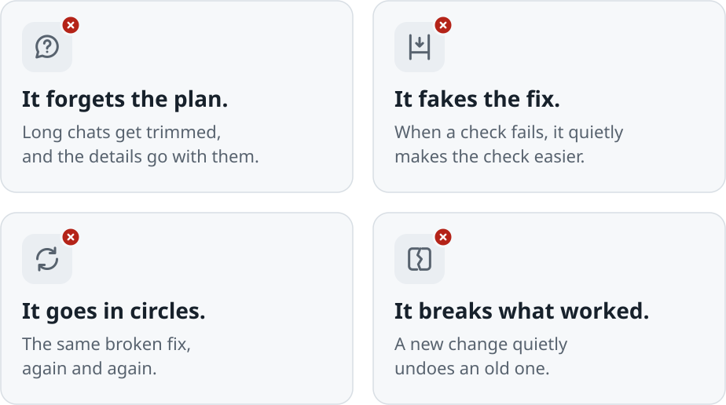
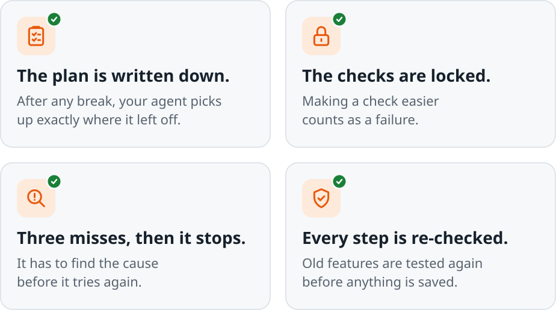
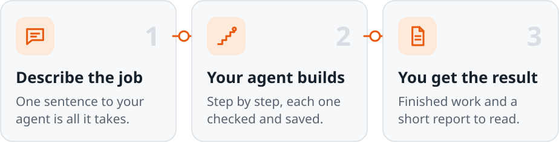
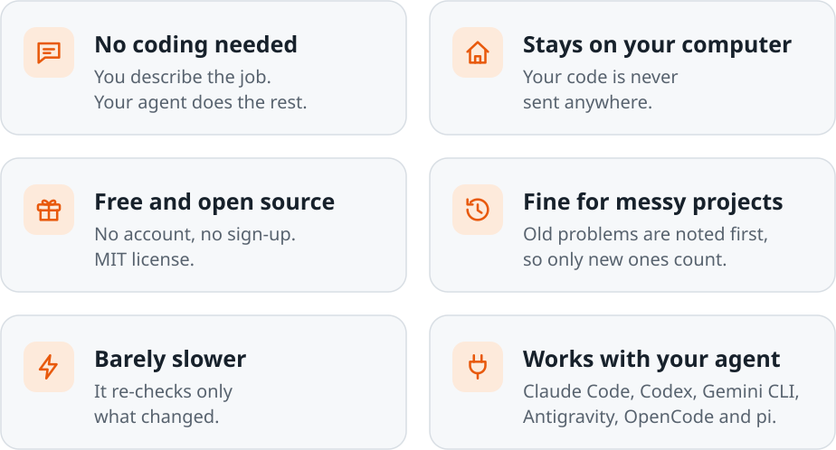

<p align="center">
  <picture>
    <source media="(prefers-color-scheme: dark)" srcset=".github/readme/hero-dark.svg">
    
  </picture>
</p>

<p align="center">
  A free add-on for coding agents like Claude Code, Codex and Gemini.<br>
  It keeps them honest and on track through long jobs.
</p>

<p align="center">
  <a href="#get-started"><b>Get started</b></a> &nbsp;·&nbsp; <a href="#good-to-know">Good to know</a> &nbsp;·&nbsp; <a href="docs/how-it-works.md">For developers</a>
</p>

<br>

## Big jobs are where agents slip

You ask your agent to build something big. It starts strong. A few hours in:

<picture>
  <source media="(prefers-color-scheme: dark)" srcset=".github/readme/slips-dark.svg">
  
</picture>

## Sci-Harness catches every slip

Climbers clip into a harness so that a slip never sends them to the bottom. Sci-Harness does the same for your
agent. Every finished step is checked and saved, so a mistake costs one step, not the whole job.

<picture>
  <source media="(prefers-color-scheme: dark)" srcset=".github/readme/catches-dark.svg">
  
</picture>

## One evening, start to finish

At 6 PM you ask your agent for a shopping cart, then step away.

<picture>
  <source media="(prefers-color-scheme: dark)" srcset=".github/readme/story-dark.svg">
  
</picture>

## How you use it

<picture>
  <source media="(prefers-color-scheme: dark)" srcset=".github/readme/steps-dark.svg">
  
</picture>

## Get started

**1. Install it.** Open Terminal on a Mac or Linux, or PowerShell on Windows, and paste one line.

Mac or Linux:

```bash
curl -fsSL https://raw.githubusercontent.com/Nag681/sci-harness/main/install.sh | sh
```

Windows:

```powershell
irm https://raw.githubusercontent.com/Nag681/sci-harness/main/install.ps1 | iex
```

**2. Give your agent a big job.** Restart your agent, open your project and type:

> **`/sci add a shopping cart to my store`**

<sub>No `/` commands in your agent? Write “Use the sci skill to …” instead. Sci-Harness needs Python and Git on
your computer.</sub>

## Good to know

<picture>
  <source media="(prefers-color-scheme: dark)" srcset=".github/readme/facts-dark.svg">
  
</picture>

<details>
<summary><b>Update or remove it</b></summary>
<br>

To update, paste the install line again. To remove it:

```bash
curl -fsSL https://raw.githubusercontent.com/Nag681/sci-harness/main/install.sh | sh -s -- --uninstall
```

```powershell
$env:SCI_ARGS = "--uninstall"; irm https://raw.githubusercontent.com/Nag681/sci-harness/main/install.ps1 | iex
```

</details>

<br>

<p align="center">
  <sub>Curious how it works under the hood? Read the <a href="docs/how-it-works.md">developer guide</a>. · <a href="LICENSE">MIT license</a></sub>
</p>
