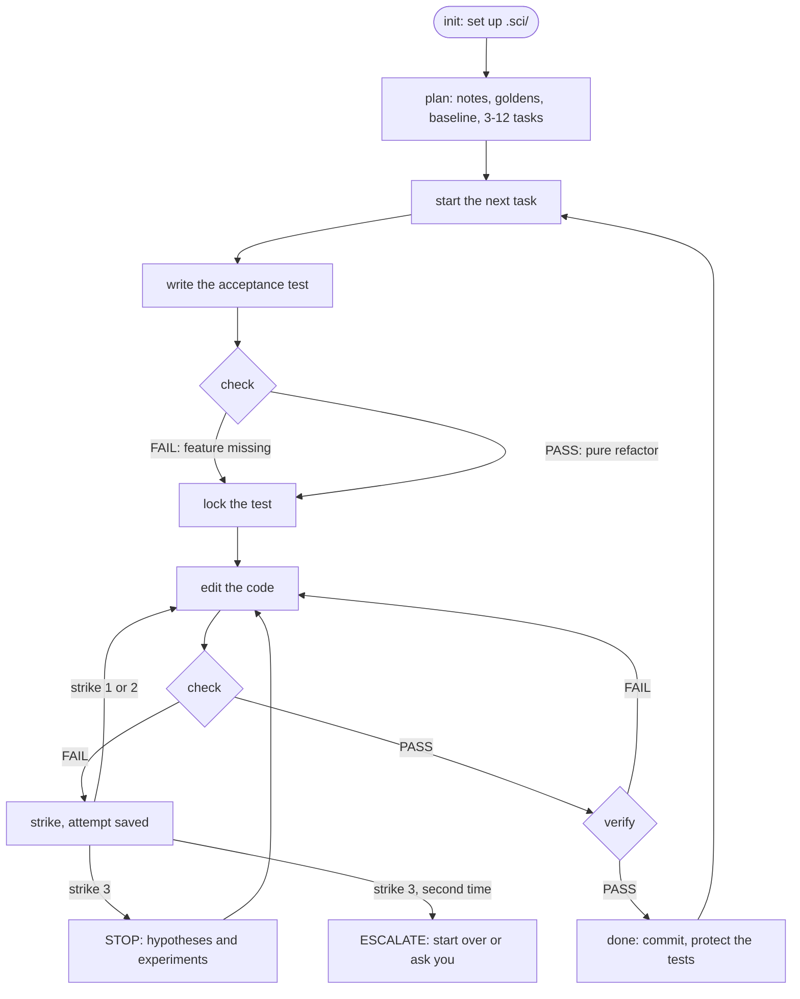

<div align="center">

# sci-harness

**Keeps small, inexpensive coding models on track in long scientific coding tasks.**

[](https://github.com/Nag681/sci-harness/actions/workflows/ci.yml)
[](#install)
[](#install)
[](scripts/sci.py)
[](LICENSE)

[Install](#install) · [Quick start](#quick-start) · [See it work](#see-it-work) · [What it fixes](#what-it-fixes) · [How it works](#how-it-works) · [FAQ](#faq)

</div>

<br>

An [Agent Skill](https://agentskills.io) named `software-engineer` for **Claude Code, Codex CLI, Gemini CLI,
Antigravity, OpenCode and pi**. It gives the agent a plan that lives on disk, acceptance tests it can't weaken,
checks on the numbers and an undo that never loses work, so long tasks survive context compaction and
small-model mistakes.

## Install

**Linux · macOS · WSL**

```bash
curl -fsSL https://raw.githubusercontent.com/Nag681/sci-harness/main/install.sh | sh
```

**Windows · PowerShell**

```powershell
irm https://raw.githubusercontent.com/Nag681/sci-harness/main/install.ps1 | iex
```

**Windows · Command Prompt**

```bat
curl -fsSLo %TEMP%\sci.ps1 https://raw.githubusercontent.com/Nag681/sci-harness/main/install.ps1 && powershell -NoProfile -ExecutionPolicy Bypass -File %TEMP%\sci.ps1
```

> [!NOTE]
> Needs **Python 3.8+** and **git**. The installer finds your agents and links the skill into each one.
> Run the same command again to update. For flags such as `--hooks` or `--uninstall`, see
> [install options](#install-options).

## Quick start

1. **Open your agent** in the repository you want to change.
2. **Name the skill and the goal**, for example:
   *"Use the software-engineer skill to add an RK2 integrator to the orbit solver."*
   In Claude Code you can also type `/software-engineer`.
3. **Let it work.** The agent splits the goal into small tasks. For each one it writes a failing test, locks
   it, makes it pass and commits ([step by step](#step-by-step)).

Check in whenever you like:

| Command | What you get |
| --- | --- |
| `.sci/sci resume` | where things stand and the next step |
| `.sci/sci report` | a summary, plus everything that needs your review |
| `.sci/sci review` | what to look over: unlocked tests, spec and scope changes, golden updates |
| `.sci/sci task unblock T3 --answer "..."` | an answer to a question the agent parked for you |
| `.sci/sci pause` / `unpause` | a quiet harness in this repo, and back |

## See it work

After a context compaction, one command puts the agent back on track:

```console
$ .sci/sci resume
=== .sci/sci resume | session 2 | sci/rk2 @ baf57490 | 4 changed/untracked files | sci 3.0.0 ===
OBJECTIVE: Add an RK2 integrator to the orbit solver
PROGRESS: 0/2 done, 0 blocked, 1 todo
  [>] T1 RK2 step with second-order convergence  <- ACTIVE
  [ ] T2 Use RK2 in the orbit propagator
ACTIVE T1: RK2 step with second-order convergence
  verify: python3 -m unittest tests.test_rk2 -q
  scope : orbits/integrators.py, tests/test_rk2.py
  invariants: observed order 2 +/- 0.2
  locked: tests/test_rk2.py
  last check: FAIL 0s ago | strikes 1/3 | verify: never
  failing: tests.test_rk2.TestRK2.test_second_order
BASELINE: 0 known pre-existing failures (not your job unless a task says so)
NEXT: Fix the code (not the tests), then `.sci/sci check`. Strike 1/3.
```

After three failed fixes in a row, it stops the guessing:

```console
$ .sci/sci check
!!! STOP is active for T1 (details at the end of this output).
FAIL check T1: exit 1 in 0.1s | log .sci/runs/0005-check-T1.log
  $ python3 -m unittest tests.test_rk2 -q
  summary: Ran 1 test in 0.000s | FAILED (failures=1)
  failing (1): tests.test_rk2.TestRK2.test_second_order
  ...
Attempt saved: .sci/attempts/T1-strike3-1793030073.patch
!!! STOP: 3 failed fix attempts in a row. Do NOT edit code now.
!!! 1) .sci/sci hyp add "<specific, testable cause>"  (at least 2 hypotheses)
!!! 2) test each with a tiny experiment (print/probe/script in .sci/scratch), not a code fix
!!! 3) .sci/sci hyp refute H<n> "<evidence>"  or  .sci/sci hyp confirm H<n> "<evidence>"
!!! Then fix only the confirmed cause. Undo bad edits with: .sci/sci restore
```

## What it fixes

| Small models tend to… | sci-harness… |
| --- | --- |
| 🧠 lose the plan when the context is compacted | keeps the plan, notes and progress in `.sci/`; every command ends with `NEXT:` |
| 🧪 "fix" a failing test by weakening it | locks acceptance tests and flags loosened tolerances, removed asserts and skips |
| 🔢 change results silently | re-checks golden outputs and every finished task on each `verify` |
| 🔁 loop on random edits | stops after 3 failed fixes until hypotheses are tested |
| 🧹 wipe work with git | saves each attempt before undoing; optional hooks block `git reset --hard` |
| 📜 drown in output | caps what the agent sees; full logs stay in `.sci/runs/` |

## How it works

sci-harness has three parts:

| Part | What it is | Its job |
| --- | --- | --- |
| 📓 **Notebook** | the `.sci/` folder in your project | remembers the goal, the tasks, every result and everything learned, even after the agent's memory is wiped |
| ⚖️ **Referee** | the program `.sci/sci` | runs the tests, records the results, refuses shortcuts and ends every answer with a `NEXT:` step |
| 📋 **Rulebook** | [`SKILL.md`](SKILL.md) | tells the agent to trust the referee over its own memory, never to weaken a test, and to stop guessing after 3 failed fixes |

The agent writes the code; sci never does. It checks, records and, when asked, undoes. Optional
[hooks](#reference) (off by default) also repeat a short reminder of the plan every turn and block git
commands that destroy work.



### Step by step

The running example: the goal is *"Add an RK2 integrator to the orbit solver"*. RK2 is a more accurate way to move
a simulation forward in time than the simple Euler method the code uses now. Every command below is run as
`.sci/sci <command>` from the repository root.

1. **Set up** (once per project): `python3 <skill folder>/scripts/sci.py init --objective "..."`
   - sci creates `.sci/` and tells git to ignore it, so it is never committed.
   - It finds your test command (for example `pytest`) and saves a map of the code.
   - On `main`, it suggests a separate git branch.

2. **Plan** (before any code changes)
   - The agent explores the code (`map`, `find`) and writes facts down, for example
     `note "positions are in metres, time in seconds"`.
   - **Goldens:** it saves the numbers the program prints today, such as the final orbit position. Later, sci
     reruns that command and compares every number to about 12 significant digits, so a change in the results
     never goes unnoticed.
   - **Baseline:** it runs your test suite once and records which tests already fail. From then on, only *new*
     failures count against the agent.
   - **Tasks:** it splits the goal into 3–12 small tasks. Each task gets a *verify command* (one command that
     passes only when the task is done), a *scope* (the files it may change), optional *invariants* (facts that
     must stay true, like "energy is conserved") and optional *dependencies* (T2 waits for T1).

3. **Start a task**: `task start`
   - sci picks the first task whose dependencies are done and takes a snapshot of every file: the task's start
     point.

4. **Write a failing test first**: `check`
   - The agent writes the *acceptance test*, the test that proves the task works, and runs `check`.
   - For a new feature the result must be **FAIL**: the feature doesn't exist yet, and a test that already passes
     proves nothing. For a pure clean-up that shouldn't change behavior, PASS is expected.

5. **Lock the test**: `lock`
   - sci saves a fingerprint and a copy of the test file. If that file changes in any way, every later check
     counts as FAIL, even when the tests pass. The agent can't make the exam easier.
   - If the test itself is wrong, the agent must `unlock` it with a written reason, and that always lands on
     your review list.

6. **Fix the code in small steps**: edit, `check`, edit, `check`, …
   - **PASS:** sci saves the files as a restore point and resets the strike counter.
   - **FAIL after a code change:** one *strike*, and the attempt is saved as a patch in `.sci/attempts/`, so no
     work is ever lost. Failures before the lock, or rerunning without changing anything, don't count.
   - sci warns when the change grows past 400 lines or touches files outside the task's scope.
   - `restore` undoes: back to the last PASS, or to the task's start. It saves the current version as a patch
     first and always puts locked tests back exactly.

7. **Stuck? STOP and think** (after 3 strikes in a row)
   - sci prints **STOP**: no more code edits. The agent writes at least two possible causes (`hyp add`), tests
     each with a small experiment (`run`), and marks them refuted or confirmed with the evidence.
   - STOP lifts once there are two new hypotheses and at least one has been tested, or when a check passes.
   - If 3 more fixes fail after that (6 in all), sci says **ESCALATE**: start the task over with a different
     approach, or block it and ask you.
   - Refuted causes appear as *RULED OUT* in every later briefing, so the agent never retries a dead end.

8. **Check everything**: `verify` runs these in order and stops at the first failure:
   1. the guard: the locked test is untouched, tests from finished tasks are untouched, no other test was
      weakened (an added skip, a deleted assert, a looser tolerance, a changed expected number, an `assert True`),
      and nobody edited the task list by hand
   2. the build, for compiled code
   3. this task's verify command
   4. the verify command of every finished task, so new work can't break old work (a *regression*)
   5. every golden
   6. the whole test suite, compared with the baseline

   sci remembers exactly which file contents passed. `verify --quick` runs only the first three steps.

9. **Finish**: `done -m "summary"`
   - sci refuses unless the full verify passed on exactly the current files (edit anything afterwards and you
     verify again), the test is locked, nothing changed outside the scope and no debugger statements are left.
     A justified change outside the scope is allowed, but it lands on your review list.
   - Then it commits only this task's files, tagged `[T1]`, and the task's tests become *protected*: every later
     task is checked against them.

10. **Repeat, and recover at any time**
    - `NEXT:` names the next task. After a memory wipe, `resume` prints the goal, the task list, the active task,
      the last result, ruled-out causes, notes and the next step. `.sci/HANDOFF.md` holds the same in a readable
      form.
    - When every task is done: a final `verify`, then `report` for you, with everything that needs your review.

### How sci picks the next step

Every command ends with a `NEXT:` line. sci takes the first row that applies:

| Situation | `NEXT:` tells the agent to… |
| --- | --- |
| the harness is paused | wait (`.sci/sci unpause` resumes) |
| no goal yet | set the objective |
| no tasks yet | explore, add 3–12 tasks and record the baseline |
| STOP is active | write and test hypotheses (ESCALATE on the second STOP) |
| a locked or protected test was changed | undo that change |
| the test isn't locked yet | write the acceptance test, `check`, then `lock` |
| the last check failed | fix the code, not the tests (strike n/3) |
| the checks pass | run `verify` (again, if files changed since) |
| verified | run `done` |
| no task is active | start the next task whose dependencies are done |
| every task is done | run a final `verify`, then `report` |
| only blocked tasks are left | ask you their questions |

### What's inside `.sci/`

| Path | Holds |
| --- | --- |
| `state.json` | the plan: goal, tasks, locks, hypotheses, notes, goldens |
| `HANDOFF.md` | a readable summary, rewritten after every change |
| `events.jsonl` | a diary of everything that happened |
| `runs/` | the full output of every command sci ran |
| `attempts/` | failed and undone attempts, as patches |
| `golden/` | the saved reference numbers |
| `scratch/` | the agent's experiments (never committed) |

`.sci/` is listed in `.git/info/exclude`, so it never lands in a commit. sci also keeps a backup of the plan and
settings inside `.git/`: if `.sci/` gets deleted, running `init` again brings them back.

<details>
<summary><b>Words used above</b></summary>

| Word | Meaning |
| --- | --- |
| agent | an AI that edits code and runs commands for you (Claude Code, Codex, …) |
| context compaction | an agent can only see so much text at once; in a long session, older parts get summarized and details are lost |
| acceptance test | the test that proves a task is done |
| regression | something that used to work and now doesn't |
| golden output | saved "known good" numbers that later runs are compared with |
| tolerance | how far two numbers may differ and still count as equal (computer arithmetic with decimals is never exact) |
| invariant | something that must stay true, like conserved energy or a positive mass |
| snapshot, restore point | a record of the exact content of every file at one moment |
| patch | a file that describes changes; `git apply <patch>` brings them back |
| scope | the files a task is allowed to change |
| commit | a saved version in git's history |

</details>

## Supported agents

| Agent | Skill | Optional hooks |
| --- | :---: | :---: |
| Claude Code | ✅ | ✅ |
| Codex CLI | ✅ | ✅ ¹ |
| Gemini CLI | ✅ | ✅ |
| Antigravity | ✅ | ✅ |
| OpenCode | ✅ | — |
| pi | ✅ | — |
| any other skills folder | `--target <dir>` | — |

¹ Codex runs hooks only with `[features] hooks = true` in its `config.toml`.

## FAQ

<details>
<summary><b>Does anything leave my machine?</b></summary>

No. sci is a local script and makes no network connections. Only the installer downloads anything: this
repository, from GitHub.

</details>

<details>
<summary><b>What does it do with git?</b></summary>

When a task is done, sci commits that task's files (turn this off with `.sci/sci config set commit false`). It
keeps checkpoints under `refs/sci/`, saves your current version as a patch before any undo, and never pushes.

</details>

<details>
<summary><b>Is it only for small models?</b></summary>

No. It is tuned for small models, but larger ones get the same safety rails on long tasks.

</details>

<details>
<summary><b>How do I update or uninstall?</b></summary>

Run the install command again to update. To remove everything the installer added, run it with `--uninstall`
(see [install options](#install-options)). Inside a repository, `.sci/sci purge --yes` deletes the harness state.

</details>

## Reference

<a id="install-options"></a>
<details>
<summary><b>Install options</b></summary>

| Option | Effect |
| --- | --- |
| `--hooks` | add the optional hooks (each config file is backed up first) |
| `--remove-hooks` | remove the hooks, keep the skill |
| `--status` | show what is installed where |
| `--uninstall` | remove everything the installer added |
| `--only claude,codex` | only these agents |
| `--copy` | copies instead of symlinks |
| `--project <repo>` | put the skill into a repository for the whole team |
| `--target <dir>` | also install into another skills directory |
| `--dry-run` | show the changes, make none |

```bash
curl -fsSL https://raw.githubusercontent.com/Nag681/sci-harness/main/install.sh | sh -s -- --hooks
```

```powershell
$env:SCI_ARGS = "--hooks"; irm https://raw.githubusercontent.com/Nag681/sci-harness/main/install.ps1 | iex
```

- Command Prompt: add the options after `%TEMP%\sci.ps1`.
- A tagged version instead of `main`: set `SCI_REF=v3.0.0` first.
- From a clone: `python3 install.py <options>`.
- Prefer to read the script first? Download it, read it, then run `sh install.sh`
  (Windows: `powershell -ExecutionPolicy Bypass -File install.ps1`).

</details>

<details>
<summary><b>Where it installs</b></summary>

The skill lives in `~/.local/share/agent-skills/software-engineer`. Each agent gets a link to it:

| Agent | Skill folder | Hooks go into |
| --- | --- | --- |
| Claude Code | `~/.claude/skills/` | `~/.claude/settings.json` |
| Codex CLI | `~/.agents/skills/` | `~/.codex/hooks.json` |
| Gemini CLI | `~/.agents/skills/` | `~/.gemini/settings.json` |
| Antigravity | `~/.gemini/config/plugins/software-engineer/` | the plugin's `hooks.json` |
| OpenCode, pi | `~/.agents/skills/` | (no hooks) |
| anything else | `--target <dir>` | (no hooks) |

Updates replace what the installer put there itself. Anything else in the way is moved to
`~/.local/share/agent-skills/backups/`, never deleted. Restart running agents after installing.

</details>

<details>
<summary><b>Optional hooks</b></summary>

Off unless you install with `--hooks`. They do nothing outside repositories that use the harness.

| When | What happens |
| --- | --- |
| session start, after compaction | the agent is told where the plan is and what to do next |
| every turn | a short reminder: objective, progress, active task, last check, next step |
| before a shell command | commands that destroy work (`git reset --hard`, `git clean`, ...) are blocked |
| Antigravity stop | with `autopilot` on, the agent is asked to continue while tasks remain |

The hooks never approve anything on their own; your agent's permission settings still apply.

</details>

<details>
<summary><b>Windows notes</b></summary>

- Python from python.org or `winget install Python.Python.3.12`.
- Without Developer Mode, agents get copies instead of links. Run the installer again after updating.
- sci runs check/verify commands with Git Bash: use forward slashes (`tests/test_x.py`).
  Change it with `.sci/sci config set shell cmd` (or `pwsh`).
- The tool is `.sci/sci` in PowerShell and Git Bash, `.sci\sci` in the Command Prompt.

</details>

<details>
<summary><b>Development</b></summary>

```bash
python3 -m unittest discover -s tests
SCI_TEST_PYTEST_PY=/path/to/python-with-pytest python3 -m unittest discover -s tests   # adds pytest cases
```

CI runs the tests on Linux, macOS and Windows and runs the install commands above on every push.
`SCI_SOURCE=<folder or archive>` makes the installers work offline; `GH_TOKEN` lets them fetch a
private fork. Changes are listed in [CHANGELOG.md](CHANGELOG.md).

</details>

## License

[MIT](LICENSE)
