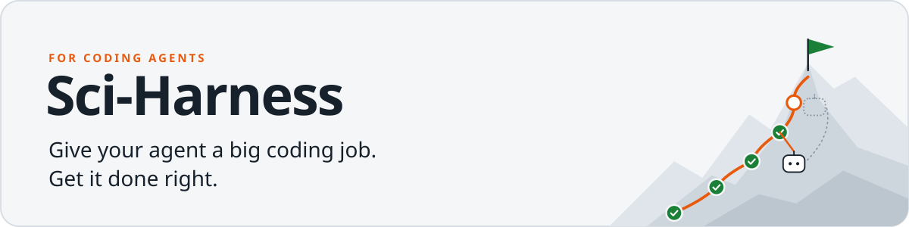

<picture>
  <source media="(prefers-color-scheme: dark)" srcset=".github/readme/hero-dark.svg">
  
</picture>

A free add-on for coding agents like Claude Code, Codex and Gemini. It keeps them honest and on track through
long jobs, and lets you switch agents halfway through without starting over.

**[Get started](#get-started)** · [Switch agents](#switch-agents-mid-job) · [Good to know](#good-to-know) ·
[For developers](docs/how-it-works.md)

## Big jobs are where agents slip

Agents slip on long jobs in four ways. Sci-Harness works like a climber's harness: every finished step is checked
and saved, and every failed fix is kept, so a slip costs one step, not the whole job.

| Without Sci&#8209;Harness | With Sci&#8209;Harness |
| --- | --- |
| ❌ **It forgets the plan.** Long chats get trimmed, and the details go with them. | ✅ **The plan is written down.** After any break, your agent, or a different one, picks up where it left off. |
| ❌ **It fakes the fix.** When a check fails, it quietly makes the check easier. | ✅ **The checks are locked.** Making a check easier counts as a failure. Changing one takes a reason, and you see every one. |
| ❌ **It goes in circles.** The same broken fix, again and again. | ✅ **Three misses, then it stops.** Before it tries again, it must test what is really causing the problem. If it skips that, you're told. |
| ❌ **It breaks what worked.** A new change quietly undoes an old one. | ✅ **Every step is re-checked.** Old features are tested again before anything is saved. |

## Switch agents mid-job

Out of usage halfway through a job? Open another agent in the same project folder and type **`/sci`**. Claude Code
to Codex, or Gemini CLI to OpenCode: the plan, the locked checks and every cause already ruled out are saved in
your project, not in one chat. The new agent picks up where the last one stopped, with no copied chats and no
re-explaining. Even a test run that was still going finishes, and its result is waiting.

## Get started

**1. Install it.** Open Terminal on a Mac or Linux, or PowerShell on Windows, and paste one line.

Mac or Linux:

```bash
curl -fsSL https://raw.githubusercontent.com/Nag681/sci-harness/main/install.sh | sh
```

Windows:

```powershell
irm https://raw.githubusercontent.com/Nag681/sci-harness/main/install.ps1 | iex
```

**2. Give your agent a big job.** Restart your agent, open your project and type **`/sci`**, then the job in one
sentence.

**3. Read the report.** When the job is done, your agent tells you what changed and what it needs from you. It
also lists every rule it bent on the way, such as a test it changed or work outside its task, so you know exactly
where to look.

<sub>No `/` commands in your agent? Write “Use the sci skill to …” instead. Sci-Harness needs Python and Git on
your computer.</sub>

## Good to know

- **No coding needed.** You describe the job. Your agent does the rest.
- **Questions don't stop the job.** When something is unclear, your agent asks you and carries on with the rest.
- **Fine for messy projects.** Old problems are noted first, so only new ones count.
- **Careful with numbers.** For science and data code, key results are saved before a change, and any that move
  are caught.
- **Slow tests are safe.** A long test run keeps going even if your agent times out or closes, and its result is
  kept.
- **A clean history.** Each finished step is one commit that says what was checked and what you should review.
  Sci-Harness's own notes never go into your project's history.
- **Barely slower.** While it works, it runs only the current step's test, and it skips checks that already
  passed on the same code.
- **Stays on your computer.** Sci-Harness never sends your code anywhere.
- **Free and open source.** No account, no sign-up. MIT license.
- **Works with your agent.** Claude Code, Codex, Gemini CLI, Antigravity, OpenCode and pi, or any agent that can
  run commands.

<details>
<summary><b>Update or remove it</b></summary>

To update, paste the install line again. To remove it:

```bash
curl -fsSL https://raw.githubusercontent.com/Nag681/sci-harness/main/install.sh | sh -s -- --uninstall
```

```powershell
$env:SCI_ARGS = "--uninstall"; irm https://raw.githubusercontent.com/Nag681/sci-harness/main/install.ps1 | iex
```

</details>

<sub>How it works under the hood: the [developer guide](docs/how-it-works.md). · [MIT license](LICENSE)</sub>
