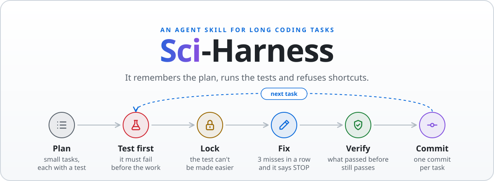
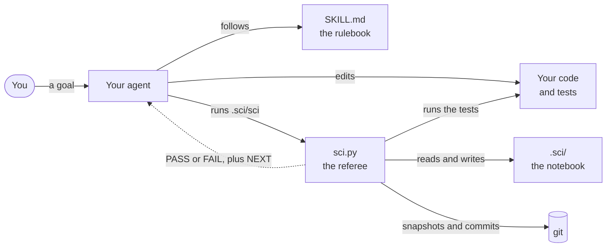
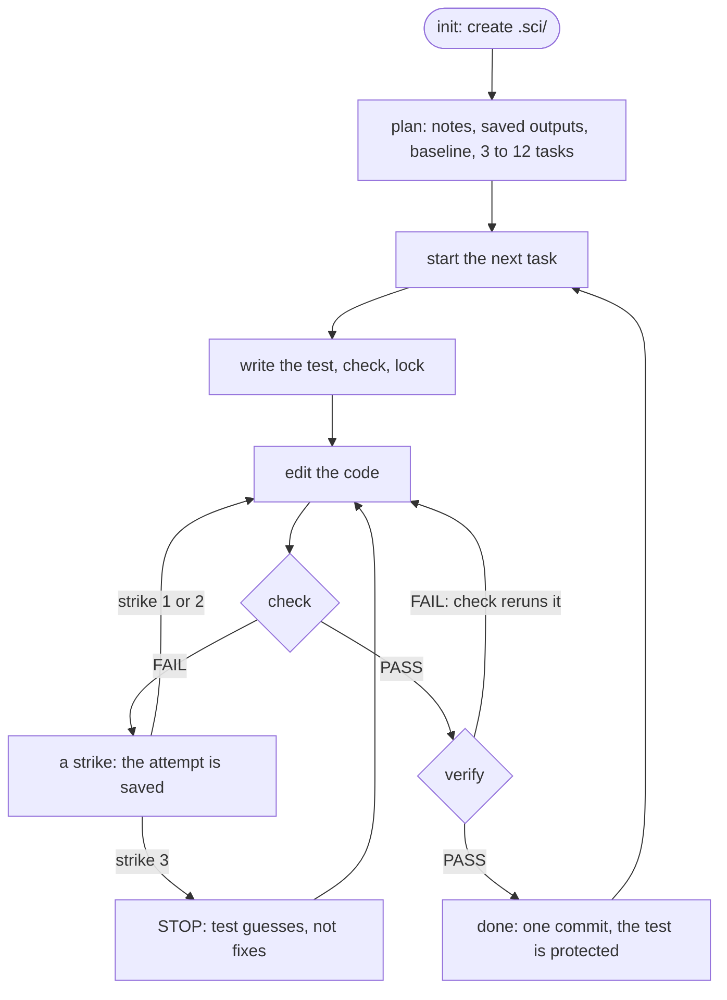
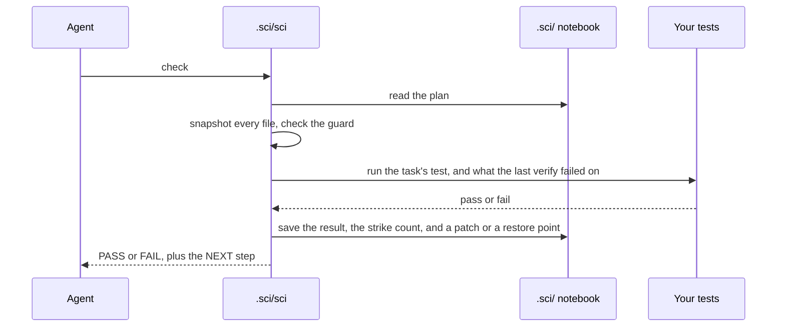

<p align="center">
  <picture>
    <source media="(prefers-color-scheme: dark)" srcset=".github/readme/banner-dark.svg">
    
  </picture>
</p>

<div align="center">

**Keeps AI coding agents on track in long, multi-step software work.**<br>
Features, bug fixes, refactors and migrations, in Python, Rust, JavaScript or any language, with small models or the largest.

[](https://github.com/Nag681/sci-harness/actions/workflows/ci.yml)
[](#install)
[](#install)
[](scripts/sci.py)
[](LICENSE)

[Install](#install) · [Use it](#use-it) · [Example](#example-a-tip-for-the-bill-splitter) · [How it works](#how-it-works) · [FAQ](#faq) · [Reference](#reference)

</div>

<br>

On a long task, an AI coding agent goes wrong in the same ways. The session gets summarized to fit the agent's
memory, and the summary drops the plan. The agent makes a failing test pass by making the test easier. When it is
stuck, it keeps guessing. Small models do this the most, and every model does it on a long enough task.

Sci-Harness gives your agent a skill called **`sci`**. The plan, the tasks and every test result live on disk in
`.sci/`, so a summarized memory loses nothing. A small tool, `.sci/sci`, runs your tests, refuses shortcuts and
ends every answer with the next step. The agent still writes all the code, and sci checks it.

| On a long task, an agent without sci… | With sci… |
| --- | --- |
| forgets the plan when its memory is summarized | `.sci/sci resume` prints the plan, the progress and the next step |
| makes a failing test pass by weakening it | the test is locked, and a looser tolerance, a deleted assert or a new skip fails the check |
| breaks yesterday's work with today's change | `verify` reruns every finished task's test, the saved outputs and your whole test suite |
| tries fix after fix without knowing why it fails | after 3 failed fixes it must STOP, write down its guesses and test them |
| wipes work with `git reset --hard` | every attempt is saved as a patch before an undo |
| fills its memory with test logs | it reads a short summary, and the full logs stay in `.sci/runs/` |

## Install

**Linux · macOS · WSL**

```bash
curl -fsSL https://raw.githubusercontent.com/Nag681/sci-harness/main/install.sh | sh
```

**Windows · PowerShell**

```powershell
irm https://raw.githubusercontent.com/Nag681/sci-harness/main/install.ps1 | iex
```

**Windows · Command Prompt**

```bat
curl -fsSLo %TEMP%\sci.ps1 https://raw.githubusercontent.com/Nag681/sci-harness/main/install.ps1 && powershell -NoProfile -ExecutionPolicy Bypass -File %TEMP%\sci.ps1
```

> [!NOTE]
> sci needs **Python 3.8 or newer** and **git**. The installer finds your agents and links the skill into each
> one. To update, run the same command again. Flags such as `--hooks` and `--uninstall` are listed under
> [install options](#install-options).

## Use it

1. **Install sci**, then restart your agent.
2. **Open your agent in your project.** The project has to be a git repository. If it isn't one yet, run
   `git init && git add -A && git commit -m start` first.
3. **Name the skill and say what you want.** In Claude Code, type `/sci add a tip option to the bill splitter`.
   In any agent, you can write *"Use the sci skill to add a tip option to the bill splitter."*
4. **Let it work.** The agent splits the job into small tasks and finishes them one at a time. Each finished
   task becomes its own git commit.
5. **Answer its questions.** When a requirement is unclear, the agent parks that task, asks you and carries on
   with the others.
6. **Read the report.** It lists what was done, the causes of the bugs the agent found and what you should look
   over.

The agent runs every `.sci/sci` command itself. You need these only to look in:

| To… | run |
| --- | --- |
| see where things stand and what comes next | `.sci/sci resume` |
| get the summary and the list of things to look over | `.sci/sci report` |
| see only what needs your review | `.sci/sci review` |
| answer a question the agent parked | `.sci/sci task unblock T3 --answer "..."` |
| switch sci off in this project, and back on | `.sci/sci pause` / `.sci/sci unpause` |

## Example: a tip for the bill splitter

A tiny app splits a restaurant bill between friends. You type:

> `/sci add a tip option to the bill splitter`

Everything quoted below is real sci output from one run of [`demo.sh`](.github/readme/demo.sh), which replays
this session. Long outputs are shortened, and `...` marks a cut.

### 1. A plan before any code

- **A note.** The agent writes down what it learns: *"split() rounds each share to cents: bill.py:6"*.
- **Saved output.** It records what the app prints today. `split(100, 3)` gives `[33.33, 33.33, 33.33]`. If a
  later change moves these numbers, `verify` says so.
- **A baseline.** It runs your tests once. From then on, only *new* failures count against the agent.
- **Two tasks.** Each one has a test that proves it is done and a list of files it may change.
  - **T1** *Add a tip option to `split()`.* It may change `bill.py` and `test_tip.py`.
  - **T2** *Show the tip on the receipt.* It may change `bill.py` and `test_receipt.py`, and it waits for T1.

<details>
<summary><b>Real output: the plan</b></summary>

```console
$ .sci/sci golden add shares --cmd "python3 -c 'from bill import split; print(split(100, 3))'"
Golden shares recorded: 3 numbers, rtol=1e-12 atol=0 (reproducible across 2 runs).

$ .sci/sci baseline
PASS baseline: exit 0 in 0.1s | log .sci/runs/0003-baseline.log
  $ python3 -m unittest discover -s . -q
  summary: Ran 2 tests in 0.000s | OK
Baseline is green: any failure of this suite later is a regression.
...

$ .sci/sci task add "Add a tip option to split()" --verify "python3 -m unittest test_tip -q" --scope bill.py --scope test_tip.py --inv "the shares add up to the bill plus tip"
Added T1: Add a tip option to split()

$ .sci/sci task add "Show the tip on the receipt" --verify "python3 -m unittest test_receipt -q" --scope bill.py --scope test_receipt.py --dep T1
Added T2: Show the tip on the receipt
[sci] no active task | NEXT: Start the next task: `.sci/sci task start` (T1: Add a tip option to split()).
```

</details>

### 2. Task T1, step by step

| | The agent… | sci… |
| :---: | --- | --- |
| 1 | writes the test first: *$100 plus a 15% tip, split 3 ways, must add up to $115.00* | ❌ **FAIL**. `split()` has no tip yet. That is the point: a test that passes before the work starts proves nothing. |
| 2 | runs `lock` | 🔒 freezes `test_tip.py`. From now on, any edit to it fails every check. |
| 3 | rounds each share to cents: 3 × $38.33 | ❌ $114.99, a cent short. **Strike 1.** The attempt is saved as a patch. |
| 4 | rounds up instead: 3 × $38.34 | ❌ $115.02. **Strike 2.** |
| 5 | loosens the test from `places=2` to `places=0` | 🔒 The test passes now, but the check counts as a FAIL: `LOCKED FILE CHANGED`. That costs no strike. The agent puts the test back with `restore`. |
| 6 | switches to exact decimal math | ❌ $114.99 again. **Strike 3: 🛑 STOP.** No more code edits until the cause is found. |
| 7 | writes two guesses. **H1**: decimal math on a computer is inexact. **H2**: rounding every share loses the leftover cent. | The STOP stays until an experiment, not another fix, settles a guess. |
| 8 | runs a short experiment through sci: even exact decimal math gives $114.99, and 11500 cents ÷ 3 leaves 1 cent over. It refutes H1 and confirms H2. | The STOP lifts. |
| 9 | gives the leftover cent to the first person: $38.34 + $38.33 + $38.33 | ✅ **PASS** |
| 10 | runs `verify` to check everything | ⚠️ The saved output moved: `split(100, 3)` now starts with 33.34 instead of 33.33. |
| 11 | explains why: *"the old shares lost a cent (3 x 33.33 = 99.99)"* | The new numbers are saved, and the change goes on **your review list**. |
| 12 | runs `verify` again | ✅ The test, the saved output and the whole test suite **PASS**. |
| 13 | runs `done` | ✅ One commit, `[T1]`, with only `bill.py` and `test_tip.py`. Their test is protected from now on. |

<details>
<summary><b>Real output: the loosened test (step 5)</b></summary>

```diff
 class TestTip(unittest.TestCase):
     def test_shares_add_up_to_bill_plus_tip(self):
         shares = split(100, 3, tip=0.15)
-        self.assertAlmostEqual(sum(shares), 115.00, places=2)
+        self.assertAlmostEqual(sum(shares), 115.00, places=0)
```

```console
$ .sci/sci check
PASS check T1: exit 0 in 0.1s | log .sci/runs/0007-check-T1.log
  $ python3 -m unittest test_tip -q
  summary: Ran 1 test in 0.000s | OK
  ...
CHECK COUNTS AS FAIL: the tests pass, but protected/locked tests were changed (see GUARD).
GUARD: LOCKED FILE CHANGED: test_tip.py
GUARD FIX: Undo it: `.sci/sci restore --paths test_tip.py`. If the test has to change because it is wrong or must follow an intended change of this task (a new signature, a renamed function): `.sci/sci unlock test_tip.py --reason "<why>"` (listed for human review).
...

$ .sci/sci restore --paths test_tip.py
Restored locked content: test_tip.py
Your previous version is saved: .sci/attempts/T1-attempt1.patch (re-apply: git apply .sci/attempts/T1-attempt1.patch)
Next: run `.sci/sci check` to confirm the state, then try a different approach.
[sci] T1 "Add a tip option to split()" | check FAIL 0s ago | strikes 2/3 | NEXT: Fix the code (not the tests), then `.sci/sci check`. Strike 2/3.
```

</details>

<details>
<summary><b>Real output: the third failed fix and the STOP (step 6)</b></summary>

```console
$ .sci/sci check
!!! STOP is active for T1 (details at the end of this output).
FAIL check T1: exit 1 in 0.1s | log .sci/runs/0008-check-T1.log
  $ python3 -m unittest test_tip -q
  summary: Ran 1 test in 0.000s | FAILED (failures=1)
  failing (1): test_tip.TestTip.test_shares_add_up_to_bill_plus_tip
  ...
  | AssertionError: 114.99 != 115.0 within 2 places (0.010000000000005116 difference)
  ...
Attempt saved: .sci/attempts/T1-strike3-1795339174.patch
!!! STOP: 3 failed fix attempts in a row. Do NOT edit code now.
!!! 1) .sci/sci hyp add "<specific, testable cause>"  (at least 2 hypotheses)
!!! 2) test each with a tiny experiment, not a code fix: .sci/sci run "python3 .sci/scratch/probe.py"
!!! 3) .sci/sci hyp refute H<n> "<evidence>"  or  .sci/sci hyp confirm H<n> "<evidence>"
!!! Then fix only the confirmed cause. Undo bad edits with: .sci/sci restore
```

</details>

<details>
<summary><b>Real output: the experiment that found the cause (steps 7 and 8)</b></summary>

```console
$ .sci/sci hyp add "computer math with decimals is inexact, so the sum comes out a cent short"
Added H1: computer math with decimals is inexact, so the sum comes out a cent short
...

$ .sci/sci hyp add "rounding every share to cents loses the leftover cent, and nobody pays it"
Added H2: rounding every share to cents loses the leftover cent, and nobody pays it
...

$ .sci/sci run 'python3 .sci/scratch/probe.py'
run 9: exit 0 in 0.0s | log .sci/runs/0009-run-T1.log
  | exact total: 115.00 | each: 38.33 | 3 shares: 114.99
  | in cents: 11500 / 3 = (3833, 1)
Cite it as evidence: .sci/sci hyp confirm|refute H<n> "run 9: <what it showed>"
STOP still active: need refute or confirm at least one.

$ .sci/sci hyp refute H1 'run 9: with exact decimal math the 3 shares still add up to 114.99'
H1 refuted.
STOP cleared: strikes reset. Fix only what the evidence supports.
...

$ .sci/sci hyp confirm H2 'run 9: 11500 cents / 3 people = 3833 each with 1 cent left over'
H2 confirmed.
```

</details>

<details>
<summary><b>Real output: verify notices the changed numbers (steps 10 to 12)</b></summary>

```console
$ .sci/sci verify
PASS task T1: reused (passed on identical code 0s ago)
FAIL golden shares: 1/3 numbers outside tolerance; max abs err 0.01, max rel err 0.0003 | log .sci/runs/0011-golden-shares.log
  value #0: reference 33.33, now 33.34
  If this change of numbers is intended (better scheme, bug fix), justify it: .sci/sci golden update shares --reason "..."
VERIFY FAIL
...

$ .sci/sci golden update shares --reason "the old shares lost a cent (3 x 33.33 = 99.99); now they add up to 100.00"
Golden shares re-recorded: 3 numbers, rtol=1e-12 atol=0 (reproducible across 2 runs).
[sci] T1 "Add a tip option to split()" | check FAIL 1s ago | strikes 0/3 | NEXT: Golden shares is up to date. Run `.sci/sci verify` again.

$ .sci/sci verify
PASS task T1: reused (passed on identical code 0s ago)
PASS golden shares: 3 numbers within rtol=1e-12 atol=0
PASS regression suite: exit 0 in 0.1s | log .sci/runs/0015-regress-T1.log
VERIFY PASS
```

</details>

### 3. If the agent's memory is summarized halfway

Long sessions fill the agent's memory, and the older parts get summarized away. Suppose that happens right after
strike 1. One command brings everything back, and the last line says what to do next:

<p align="center">
  
</p>

<details>
<summary><b>The same output as text</b></summary>

```console
$ .sci/sci resume
=== .sci/sci resume | session 2 | sci/tip @ 71513028 | 2 changed/untracked files | sci 3.4.1 ===
OBJECTIVE: Add a tip option to the bill splitter
PROGRESS: 0/2 done, 0 blocked, 1 todo
  [>] T1 Add a tip option to split()  <- ACTIVE
  [ ] T2 Show the tip on the receipt
ACTIVE T1: Add a tip option to split()
  verify: python3 -m unittest test_tip -q
  scope : bill.py, test_tip.py
  invariants: the shares add up to the bill plus tip
  locked: test_tip.py
  last check: FAIL 0s ago | strikes 1/3 | verify: never
  failing: test_tip.TestTip.test_shares_add_up_to_bill_plus_tip
NOTES (1; all in .sci/HANDOFF.md):
  N1 [code] split() rounds each share to cents: bill.py:6
GOLDENS: shares OK
BASELINE: 0 known pre-existing failures (not your job unless a task says so)
NEXT: Fix the code (not the tests), then `.sci/sci check`. Strike 1/3.
```

</details>

### 4. Task T2, and the break in T1 that it catches

T2 adds `receipt()`. Along the way, the agent adds a helper, `to_cents()`, that cuts off fractions of a cent
instead of rounding them. T2's own test passes. Then `verify` runs your whole test suite, which now includes T1's
test:

```console
$ .sci/sci verify
note: the regression suite runs the tests of T1, so their checks do not run separately.
PASS task T2: reused (passed on identical code 1s ago)
PASS golden shares: 3 numbers within rtol=1e-12 atol=0
FAIL regression suite: exit 1 in 0.1s | log .sci/runs/0019-regress-T2.log
  $ python3 -m unittest discover -s . -q
  summary: Ran 4 tests in 0.000s | FAILED (failures=1)
  failing (1): test_tip.TestTip.test_shares_add_up_to_bill_plus_tip
  ...
  | AssertionError: 114.99 != 115.0 within 2 places (0.010000000000005116 difference)
  ...
NEW FAILURES (not in baseline): test_tip.TestTip.test_shares_add_up_to_bill_plus_tip
REGRESSION: your change broke T1's tests (test_tip.TestTip.test_shares_add_up_to_bill_plus_tip). Fix the code. Change T1's tests only if they must follow an intended change of this task (`.sci/sci unlock <file> --reason "..."`).
VERIFY FAIL
[sci] T2 "Show the tip on the receipt" | check FAIL 0s ago | strikes 0/3 | NEXT: Fix the code (not the tests), then `.sci/sci check`; it also reruns what failed the last verify (regression suite). Strike 0/3.
```

The agent makes `to_cents()` round. The next `check` runs T2's test, and it also reruns the test that `verify`
failed on, so one quick check confirms the fix:

```console
$ .sci/sci check
PASS check T2: exit 0 in 0.1s | log .sci/runs/0020-check-T2.log
  $ python3 -m unittest test_receipt -q
  summary: Ran 1 test in 0.000s | OK
  ...
PASS regression suite (only the tests that failed): exit 0 in 0.1s | log .sci/runs/0021-check-T2.log
  $ python3 -m unittest test_tip.TestTip.test_shares_add_up_to_bill_plus_tip
  summary: Ran 1 test in 0.000s | OK
[sci] T2 "Show the tip on the receipt" | check PASS 0s ago | strikes 0/3 | NEXT: Checks pass. Run `.sci/sci verify` (full gate).
```

`verify` passes, and `done` commits T2.

### 5. The result

One commit per task, and a report for you:

```console
$ git log --oneline
37587fa feat: show the tip on the receipt [T2]
2a1339c feat: tip option for split() [T1]
7151302 bill splitter

$ .sci/sci report
# .sci/sci report

Objective: Add a tip option to the bill splitter
Tasks: 2/2 done, 0 blocked, 0 todo

- T1 [done] Add a tip option to split() (commit 2a1339cfed)
- T2 [done] Show the tip on the receipt (commit 37587fa0e0)

Last verify: PASS 0s ago
Goldens: shares OK

Root causes found:
- H2: rounding every share to cents loses the leftover cent, and nobody pays it (run 9: 11500 cents / 3 people = 3833 each with 1 cent left over)

NEEDS YOUR REVIEW:
- [golden-update] T1: shares re-recorded: the old shares lost a cent (3 x 33.33 = 99.99); now they add up to 100.00
```

And the app:

```console
$ python3 -c 'from bill import receipt; print(receipt(100, 3, tip=0.15))'
Bill:  $100.00
Tip:   $15.00 (15%)
Total: $115.00
Each:  $38.34, $38.33, $38.33
```

## How it works

### Three parts

| Part | What it is | Its job |
| --- | --- | --- |
| **Notebook** | the `.sci/` folder in your project | remembers the goal, the tasks, every result and everything learned, however often the agent's memory is summarized |
| **Referee** | the tool `.sci/sci` | runs the tests, records the results, refuses shortcuts and ends every answer with a `NEXT:` step |
| **Rulebook** | [`SKILL.md`](SKILL.md) | tells the agent to trust the referee over its own memory, never to weaken a test, and to stop guessing after 3 failed fixes |



sci never edits your code. It checks, records and, when the agent asks, undoes. Optional
[hooks](#optional-hooks) (off by default) also remind the agent of the plan with each of your messages and block git commands
that destroy work.

### The loop, for every task



### What one check does



The full test output goes to `.sci/runs/`. The agent reads a short summary, so logs don't fill its memory.

### The rules

| Rule | What it means |
| --- | --- |
| **Test first** | The agent writes the test before the code. For new behavior, the first `check` must FAIL. For a clean-up that shouldn't change behavior, it must PASS. |
| **Lock** | `lock` records the test files. Any change to them makes every check FAIL, even when the tests pass. To change a test that is wrong, or one that must follow an intended change such as a new signature, the agent runs `unlock` with a reason, and the reason goes on your review list. |
| **Guard** | Every `check` and `verify` also confirms that no finished task's test changed, that no test was weakened (a new skip, a deleted assert, `assert True`, a looser tolerance, a changed expected number), and that nobody edited the plan by hand. |
| **Strikes** | A strike is a failed check after a code change, once the test is locked. A PASS resets the count. Failures before the lock, reruns of unchanged code and checks that fail only on the guard are not strikes. Each strike saves the attempt as a patch in `.sci/attempts/`. |
| **STOP** | After 3 strikes in a row, the agent must stop editing code. The STOP lifts once it has written 2 guesses (*hypotheses*), run an experiment through sci and used it to rule a guess in or out, or once a check passes. |
| **ESCALATE** | After 3 more strikes (6 failed fixes), the agent starts the task over a different way or asks you. Every guess it ruled out stays listed, so it never retries a dead end. |
| **Verify** | Runs these in order and stops at the first failure: the guard, the build (for compiled code), this task's test, each finished task's test, the saved outputs (compared to about 12 digits) and the whole test suite (only new failures count). |
| **Rerun what failed** | After a failed `verify`, `check` also reruns the step that failed until it passes. For pytest and unittest it reruns only the failing tests. A fix that misses the failure is a strike. |
| **Reuse** | `verify` doesn't rerun a step that passed on the same code with the same installed packages. A finished task's test that the whole suite runs anyway runs only there, and a failure names that task. `verify --fresh` reruns everything. |
| **Done** | Refuses until `verify` has passed on the current files, the test is locked, nothing outside the task's files changed, no stray new files are left and no debugger lines remain. Edits made after `verify` to documentation, or to comments and layout in Python and Rust files, are fine unless a check reads them. Then `done` commits only the task's files, as `[T1]`, and protects their tests. |
| **Long runs** | `check`, `verify`, `run`, `baseline` and `golden` keep running in the background. After 100 seconds the agent gets `STILL RUNNING` and collects the result with `.sci/sci wait`, so a tool timeout or a restarted session loses nothing. Files edited during a run make its result not count. |
| **Restore** | Undoes to the last PASS or to the start of the task. It saves the current version as a patch first and always puts locked tests back exactly. |

<details>
<summary><b>How sci picks the next step</b></summary>

After every command, sci prints a `NEXT:` line. It takes the first row that applies:

| Situation | `NEXT:` tells the agent to… |
| --- | --- |
| the harness is paused | wait (`.sci/sci unpause` resumes) |
| a check or verify is running in the background | collect it with `.sci/sci wait` |
| there is no goal yet | set the goal |
| there are no tasks yet | explore the code, add 3 to 12 tasks and record the baseline |
| STOP is active | write and test guesses (ESCALATE on the second STOP) |
| a guard rule was broken | undo that change, or `unlock` the test with a reason |
| the test isn't locked yet | write the test, `check`, then `lock` |
| verify found changed saved outputs | fix the code, or explain the change with `golden update` and `verify` again |
| the last check or verify failed | fix the code, not the tests, then `check`, which also reruns what verify failed on (strike n/3) |
| a narrower `check --cmd` passed, but not what verify failed on | run `check` |
| the checks pass | run `verify` (again, if code changed since) |
| verified | run `done` |
| no task is active | start the next task whose dependencies are done |
| every task is done | `report` (the last task's verify was the final one; `verify` again only if files changed since) |
| only blocked tasks are left | ask you their questions |

</details>

<details>
<summary><b>What's where</b></summary>

**On your computer, installed once:** `~/.local/share/agent-skills/sci/`

| File | What it is |
| --- | --- |
| [`SKILL.md`](SKILL.md) | the rulebook your agent reads |
| [`scripts/sci.py`](scripts/sci.py) | the referee: one Python file, standard library only |
| [`scripts/sci_hook.py`](scripts/sci_hook.py) | the optional hooks |
| [`references/`](references/) | guides the agent opens when it needs them: debugging, large codebases, test recipes for numerical code and a [complete example session](references/worked-example.md) |
| [`install.py`](install.py) | the installer (`--status`, `--uninstall`, …) |

**In each project:** `.sci/`

| Path | Holds |
| --- | --- |
| `sci`, `sci.py` | the referee, copied in by `init` so the project keeps working on its own |
| `state.json` | the plan: goal, tasks, locks, guesses, notes, saved outputs |
| `config.json` | settings, such as your test command |
| `HANDOFF.md` | a readable summary, rewritten after every change |
| `events.jsonl` | a diary of everything that happened |
| `runs/` | the full output of every command sci ran |
| `jobs/` | background runs, for `.sci/sci wait` |
| `attempts/` | failed and undone attempts, as patches |
| `golden/` | the saved outputs |
| `scratch/` | the agent's experiments |

`.sci/` is listed in `.git/info/exclude`, so it never lands in a commit. sci also keeps a backup of the plan and
the settings inside `.git/`. If `.sci/` gets deleted, running `init` again brings them back.

</details>

## Works with these agents

| Agent | Skill | Optional hooks |
| --- | :---: | :---: |
| Claude Code | ✅ | ✅ |
| Codex CLI | ✅ | ✅ ¹ |
| Gemini CLI | ✅ | ✅ |
| Antigravity | ✅ | ✅ |
| OpenCode | ✅ | |
| pi | ✅ | |
| any other skills folder | `--target <dir>` | |

¹ Current Codex runs hooks unless its `config.toml` has `[features] hooks = false`; older versions need `hooks = true` there.

## FAQ

<details>
<summary><b>Is it only for scientific code?</b></summary>

No. It is a software-engineering skill: features, bug fixes, refactors, migrations and performance work. For
numerical code it adds saved reference outputs and a convergence-order check, which you can ignore when you
don't need them. The example above is a bill splitter.

</details>

<details>
<summary><b>Which languages and test runners does it support?</b></summary>

Any language whose tests run from the command line. Each task names a command, and its exit code decides PASS or
FAIL. For pytest, unittest, cargo test, cargo nextest, go, ctest, jest, vitest, `node --test`, TAP, Maven, Gradle,
dotnet, RSpec and PHPUnit, sci also reads which tests failed, so a baseline of known failures works.

Python, Rust and JavaScript/TypeScript get the most help:

- **Rust:** unit tests inside `src/*.rs` (`#[cfg(test)] mod tests`) are locked and protected on their own, so
  the agent can keep editing the code around them but not the tests.
- **JavaScript/TypeScript:** jest, vitest and `node --test` report each failing test by name, and snapshot files
  count as tests.
- **Python:** it also checks the structure of edited test code, for example a test that now returns early.

If tests import built output (a C extension, a PyO3 module), set a build command once
(`.sci/sci config set build_cmd "maturin develop"`) and sci rebuilds whenever a source file changes.

</details>

<details>
<summary><b>My project already has failing tests. Can I still use it?</b></summary>

Yes. `baseline` records the failures that exist before the work starts. `verify` fails only on new ones, and the
agent leaves the old ones alone unless a task is about them.

</details>

<details>
<summary><b>Is it only for small models?</b></summary>

No. Small models gain the most because they lose the plan soonest, but larger ones use the same loop on long
tasks. sci stays out of their way. After a failed verify, `check` reruns just what failed, so a fix takes one
quick check to confirm. Steps that passed on unchanged code are reused. A test that must follow an intended
change can be unlocked with a reason, at no strike. Edits to documentation, or to comments and layout in Python,
don't need another verify.

</details>

<details>
<summary><b>What if my tests take a long time?</b></summary>

`verify` runs each test once: a finished task's test that the whole suite runs anyway isn't run again on its own.
It also reuses any step that already passed on the same code, so verifying again after a crash costs nothing, and
a task that only edits documentation reruns only the checks that read it.

Long runs continue in the background. After 100 seconds the agent gets `STILL RUNNING` and picks up the result
with `.sci/sci wait`, so a shell-tool timeout or a restarted session doesn't lose the run. To change the 100
seconds, run `.sci/sci config set wait_secs 50`. If your agent's environment kills background processes, run
everything in the foreground with `.sci/sci config set background false`. sci tells the agent when this seems to
happen.

</details>

<details>
<summary><b>Does anything leave my machine?</b></summary>

No. sci is a local script and makes no network connections. Only the installer downloads anything: this
repository, from GitHub.

</details>

<details>
<summary><b>What does it do with git?</b></summary>

When a task is done, sci commits that task's files. To turn this off, run `.sci/sci config set commit false`, and
`done` writes a patch instead. sci keeps restore points under `refs/sci/`, saves your current version as a patch
before any undo, and never pushes.

</details>

<details>
<summary><b>How do I update or uninstall?</b></summary>

To update, run the install command again, then restart your agent so it reads the new `SKILL.md`. Each project
keeps its own copy of the tool in `.sci/`. To update that copy, run
`python3 ~/.local/share/agent-skills/sci/scripts/sci.py init` in the project. Its plan and progress stay, and
`.sci/sci resume` says when a newer version is installed. If you installed the skill under its old name,
`software-engineer`, updating renames it to `sci`.

To remove everything the installer added, run it with `--uninstall` (see [install options](#install-options)).
Inside a repository, `.sci/sci purge --yes` deletes the harness state.

</details>

## Reference

<details>
<summary><b>Commands</b></summary>

Run them from the repository root as `.sci/sci <command>`. `.sci/sci help` prints the full list with every
option.

| Command | What it does |
| --- | --- |
| `resume` | prints the goal, the tasks, the active task, ruled-out causes, notes and `NEXT:` |
| `init --objective "..."` | sets up `.sci/` in a repository (run once, as `python3 <skill folder>/scripts/sci.py init`) |
| `task add "title" --verify "cmd" --scope PATH` | adds a task; `--inv`, `--dep` and `--why` add invariants, dependencies and context |
| `task start [ID]` | starts the next task, or the one named |
| `task block ID --reason "..."` | parks a task with a question for you; `task unblock ID --answer "..."` answers it |
| `task scope GLOB` | lets the active task change more files (logged) |
| `map`, `find NAME` | an overview of the repository; the definitions and uses of a name |
| `note "fact" --kind code` | saves what the agent learned; other kinds: `units`, `derivation`, `decision`, `env`, `gotcha`, `perf` |
| `now "..."` | saves what the agent is doing right now |
| `check` | runs the task's test and what the last verify failed on, and counts strikes |
| `lock`, `unlock FILE --reason "..."` | freezes the acceptance tests; frees one for a reason you review |
| `verify` | the full gate before a commit; `--quick` runs only the guard, the build and the task's own test, `--fresh` reuses nothing |
| `done -m "summary"` | commits the task's files and protects its tests |
| `restore` | undoes safely: to the last PASS, `--to start`, or `--paths FILE` |
| `wait`, `cancel` | collects or stops a background run |
| `run "cmd"` | runs an experiment from the repository root and logs it as evidence |
| `hyp add "cause"`, `hyp refute H1 "..."`, `hyp confirm H1 "..."` | writes down a guess about a bug's cause, and its verdict |
| `golden add NAME --cmd "cmd"` | saves the numbers a command prints, to compare on every verify |
| `order --h H1 H2 H3 --err E1 E2 E3` | computes the observed convergence order of numerical code |
| `baseline` | records which tests fail before the work starts |
| `out RUN --grep PATTERN`, `log` | reads a saved log; lists recent events |
| `review`, `report` | what needs your review; the final summary |
| `pause`, `unpause` | switches sci off in this repository, and back on |
| `config` | shows the settings; `config set`, `config add` and `config remove` change them |

</details>

<details>
<summary><b>Settings</b></summary>

`.sci/sci config` shows them all. `config set KEY VALUE` replaces a value, and `config add` or `config remove`
changes one item of a list.

| Setting | Default | What it does |
| --- | --- | --- |
| `test_cmd` | detected by `init` | the project's test command |
| `regress_cmd` | set by `baseline` | the whole suite that `verify` reruns |
| `build_cmd` | none | the rebuild command, run when a file that matches `build_globs` changes |
| `background` | `true` | runs long commands as background jobs |
| `wait_secs` | `100` | how long a command waits before it prints `STILL RUNNING` |
| `check_timeout`, `verify_timeout` | `900`, `3600` | seconds before a run is stopped |
| `commit` | `true` | `done` commits; with `false`, it writes a patch instead |
| `shell` | bash (Git Bash on Windows) | the shell for task commands: a path, `cmd`, `powershell` or `pwsh` |
| `test_globs`, `doc_globs`, `build_globs`, `ignore_globs` | many | which files count as tests, documentation and build inputs, and which sci ignores |
| `autopilot` | `false` | with the Antigravity hooks, asks the agent to continue while tasks remain |

</details>

<a id="install-options"></a>
<details>
<summary><b>Install options</b></summary>

| Option | Effect |
| --- | --- |
| `--hooks` | adds the optional hooks (each config file is backed up first) |
| `--remove-hooks` | removes the hooks and keeps the skill |
| `--status` | shows what is installed where |
| `--uninstall` | removes everything the installer added |
| `--only claude,codex` | installs for these agents only |
| `--copy` | copies instead of linking |
| `--project <repo>` | puts the skill into a repository for the whole team |
| `--target <dir>` | also installs into another skills folder |
| `--dry-run` | shows the changes and makes none |

```bash
curl -fsSL https://raw.githubusercontent.com/Nag681/sci-harness/main/install.sh | sh -s -- --hooks
```

```powershell
$env:SCI_ARGS = "--hooks"; irm https://raw.githubusercontent.com/Nag681/sci-harness/main/install.ps1 | iex
```

- In the Command Prompt, add the options after `%TEMP%\sci.ps1`.
- To install a tagged version instead of `main`, first set `SCI_REF` to one of the
  [tags](https://github.com/Nag681/sci-harness/tags).
- From a clone, run `python3 install.py <options>`.
- To read the script before it runs, download it, read it, then run `sh install.sh` (on Windows,
  `powershell -ExecutionPolicy Bypass -File install.ps1`).

</details>

<details>
<summary><b>Where it installs</b></summary>

The skill lives in `~/.local/share/agent-skills/sci`. Each agent gets a link to it:

| Agent | Skill folder | Hooks go into |
| --- | --- | --- |
| Claude Code | `~/.claude/skills/` | `~/.claude/settings.json` |
| Codex CLI | `~/.agents/skills/` | `~/.codex/hooks.json` |
| Gemini CLI | `~/.agents/skills/` | `~/.gemini/settings.json` |
| Antigravity | `~/.gemini/config/plugins/sci/` | the plugin's `hooks.json` |
| OpenCode, pi | `~/.agents/skills/` | (no hooks) |
| anything else | `--target <dir>` | (no hooks) |

Updates replace only what the installer put there itself. Anything else in the way is moved to
`~/.local/share/agent-skills/backups/`, never deleted. Restart running agents after installing.

</details>

<a id="optional-hooks"></a>
<details>
<summary><b>Optional hooks</b></summary>

The hooks are off unless you install with `--hooks`. They do nothing outside repositories that use sci.

| When | What happens |
| --- | --- |
| a session starts, or (Claude Code, Antigravity) the agent's memory was summarized | the agent is told where the plan is and what to do next |
| each message you send (Antigravity: each step of the agent) | a short reminder: the goal, the progress, the active task, the last check and the next step |
| before a shell command | commands that destroy work, such as `git reset --hard` and `git clean`, are blocked |
| Antigravity stops | with `autopilot` on, the agent is asked to continue while tasks remain |

The hooks never approve anything on their own. Your agent's permission settings still apply.

</details>

<details>
<summary><b>Windows notes</b></summary>

- Install Python from python.org or with `winget install Python.Python.3.12`.
- Without Developer Mode, agents get copies instead of links. Run the installer again after updating.
- sci runs check and verify commands with Git Bash, so use forward slashes in them (`tests/test_x.py`). To use
  another shell, run `.sci/sci config set shell cmd` (or `pwsh`).
- The tool is `.sci/sci` in PowerShell and Git Bash, and `.sci\sci` in the Command Prompt.

</details>

<details>
<summary><b>Development</b></summary>

```bash
python3 -m unittest discover -s tests
SCI_TEST_PYTEST_PY=/path/to/python-with-pytest python3 -m unittest discover -s tests   # adds the pytest cases
sh .github/readme/demo.sh > demo.txt && python3 .github/readme/build.py demo.txt      # README images; checks its quotes
```

CI runs the tests on Linux, macOS and Windows and runs the install commands above on every push.
`SCI_SOURCE=<folder or archive>` makes the installers work offline, and `GH_TOKEN` lets them fetch a private
fork. Changes are listed in [CHANGELOG.md](CHANGELOG.md).

</details>

<details>
<summary><b>Words used on this page</b></summary>

| Word | Meaning |
| --- | --- |
| agent | an AI that edits code and runs commands for you, such as Claude Code or Codex |
| skill | a folder of instructions and tools that an agent loads when a task calls for it |
| memory, context | the text an agent can keep in mind at once; in a long session, older parts get summarized and details are lost |
| test, acceptance test | a small program that checks your code; the acceptance test is the one that proves a task is done |
| regression | something that used to work and doesn't anymore |
| saved output, golden | numbers a command printed when the code was known to be good, compared with every later run |
| tolerance | how far two numbers may differ and still count as equal |
| invariant | something that must stay true, such as "the shares add up to the bill" |
| hypothesis | a guess about the cause of a bug, written down so it can be tested |
| baseline | the tests that already failed before the work started |
| restore point | a record of the exact content of every file at one moment |
| patch | a file that describes changes; `git apply <patch>` brings them back |
| scope | the files a task may change |
| commit | a saved version in git's history |

</details>

## License

[MIT](LICENSE)
