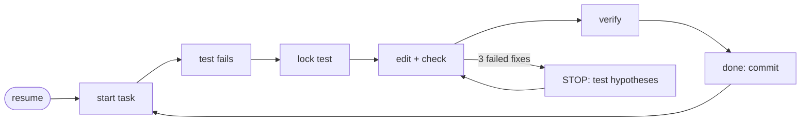

<div align="center">

# sci-harness

**Keeps small, inexpensive coding models on track in long scientific coding tasks.**

[](https://github.com/Nag681/sci-harness/actions/workflows/ci.yml)
[](#install)
[](#install)
[](scripts/sci.py)
[](LICENSE)

[Install](#install) · [Quick start](#quick-start) · [See it work](#see-it-work) · [What it fixes](#what-it-fixes) · [How it works](#how-it-works) · [FAQ](#faq)

</div>

<br>

An [Agent Skill](https://agentskills.io) named `software-engineer` for **Claude Code, Codex CLI, Gemini CLI,
Antigravity, OpenCode and pi**. It gives the agent a plan that lives on disk, acceptance tests it can't weaken,
checks on the numbers and an undo that never loses work, so long tasks survive context compaction and
small-model mistakes.

## Install

**Linux · macOS · WSL**

```bash
curl -fsSL https://raw.githubusercontent.com/Nag681/sci-harness/main/install.sh | sh
```

**Windows · PowerShell**

```powershell
irm https://raw.githubusercontent.com/Nag681/sci-harness/main/install.ps1 | iex
```

**Windows · Command Prompt**

```bat
curl -fsSLo %TEMP%\sci.ps1 https://raw.githubusercontent.com/Nag681/sci-harness/main/install.ps1 && powershell -NoProfile -ExecutionPolicy Bypass -File %TEMP%\sci.ps1
```

> [!NOTE]
> Needs **Python 3.8+** and **git**. The installer finds your agents and links the skill into each one.
> Run the same command again to update. For flags such as `--hooks` or `--uninstall`, see
> [install options](#install-options).

## Quick start

1. **Open your agent** in the repository you want to change.
2. **Name the skill and the goal**, for example:
   *"Use the software-engineer skill to add an RK2 integrator to the orbit solver."*
   In Claude Code you can also type `/software-engineer`.
3. **Let it work.** The agent splits the goal into small tasks. For each one it writes a failing test, locks
   it, makes it pass and commits.

Check in whenever you like:

| Command | What you get |
| --- | --- |
| `.sci/sci resume` | where things stand and the next step |
| `.sci/sci report` | a summary, plus everything that needs your review |
| `.sci/sci review` | what to look over: unlocked tests, spec and scope changes, golden updates |
| `.sci/sci task unblock T3 --answer "..."` | an answer to a question the agent parked for you |
| `.sci/sci pause` / `unpause` | a quiet harness in this repo, and back |

## See it work

After a context compaction, one command puts the agent back on track:

```console
$ .sci/sci resume
=== .sci/sci resume | session 2 | sci/rk2 @ baf57490 | 4 changed/untracked files | sci 3.0.0 ===
OBJECTIVE: Add an RK2 integrator to the orbit solver
PROGRESS: 0/2 done, 0 blocked, 1 todo
  [>] T1 RK2 step with second-order convergence  <- ACTIVE
  [ ] T2 Use RK2 in the orbit propagator
ACTIVE T1: RK2 step with second-order convergence
  verify: python3 -m unittest tests.test_rk2 -q
  scope : orbits/integrators.py, tests/test_rk2.py
  invariants: observed order 2 +/- 0.2
  locked: tests/test_rk2.py
  last check: FAIL 0s ago | strikes 1/3 | verify: never
  failing: tests.test_rk2.TestRK2.test_second_order
BASELINE: 0 known pre-existing failures (not your job unless a task says so)
NEXT: Fix the code (not the tests), then `.sci/sci check`. Strike 1/3.
```

After three failed fixes in a row, it stops the guessing:

```console
$ .sci/sci check
!!! STOP is active for T1 (details at the end of this output).
FAIL check T1: exit 1 in 0.1s | log .sci/runs/0005-check-T1.log
  $ python3 -m unittest tests.test_rk2 -q
  summary: Ran 1 test in 0.000s | FAILED (failures=1)
  failing (1): tests.test_rk2.TestRK2.test_second_order
  ...
Attempt saved: .sci/attempts/T1-strike3-1793030073.patch
!!! STOP: 3 failed fix attempts in a row. Do NOT edit code now.
!!! 1) .sci/sci hyp add "<specific, testable cause>"  (at least 2 hypotheses)
!!! 2) test each with a tiny experiment (print/probe/script in .sci/scratch), not a code fix
!!! 3) .sci/sci hyp refute H<n> "<evidence>"  or  .sci/sci hyp confirm H<n> "<evidence>"
!!! Then fix only the confirmed cause. Undo bad edits with: .sci/sci restore
```

## What it fixes

| Small models tend to… | sci-harness… |
| --- | --- |
| 🧠 lose the plan when the context is compacted | keeps the plan, notes and progress in `.sci/`; every command ends with `NEXT:` |
| 🧪 "fix" a failing test by weakening it | locks acceptance tests and flags loosened tolerances, removed asserts and skips |
| 🔢 change results silently | re-checks golden outputs and every finished task on each `verify` |
| 🔁 loop on random edits | stops after 3 failed fixes until hypotheses are tested |
| 🧹 wipe work with git | saves each attempt before undoing; optional hooks block `git reset --hard` |
| 📜 drown in output | caps what the agent sees; full logs stay in `.sci/runs/` |

## How it works



- **One small tool.** [`scripts/sci.py`](scripts/sci.py) is a single standard-library Python file. Its state lives
  in `<repo>/.sci/`, which is never committed.
- **Clear rules.** [`SKILL.md`](SKILL.md) tells the agent which command to run when. [`references/`](references/)
  holds test templates and a [worked example](references/worked-example.md).
- **Optional hooks** brief the agent again after compaction and block destructive git commands. They stay off
  unless you install with `--hooks`.

## Supported agents

| Agent | Skill | Optional hooks |
| --- | :---: | :---: |
| Claude Code | ✅ | ✅ |
| Codex CLI | ✅ | ✅ ¹ |
| Gemini CLI | ✅ | ✅ |
| Antigravity | ✅ | ✅ |
| OpenCode | ✅ | — |
| pi | ✅ | — |
| any other skills folder | `--target <dir>` | — |

¹ Codex runs hooks only with `[features] hooks = true` in its `config.toml`.

## FAQ

<details>
<summary><b>Does anything leave my machine?</b></summary>

No. sci is a local script and makes no network connections. Only the installer downloads anything: this
repository, from GitHub.

</details>

<details>
<summary><b>What does it do with git?</b></summary>

When a task is done, sci commits that task's files (turn this off with `.sci/sci config set commit false`). It
keeps checkpoints under `refs/sci/`, saves your current version as a patch before any undo, and never pushes.

</details>

<details>
<summary><b>Is it only for small models?</b></summary>

No. It is tuned for small models, but larger ones get the same safety rails on long tasks.

</details>

<details>
<summary><b>How do I update or uninstall?</b></summary>

Run the install command again to update. To remove everything the installer added, run it with `--uninstall`
(see [install options](#install-options)). Inside a repository, `.sci/sci purge --yes` deletes the harness state.

</details>

## Reference

<a id="install-options"></a>
<details>
<summary><b>Install options</b></summary>

| Option | Effect |
| --- | --- |
| `--hooks` | add the optional hooks (each config file is backed up first) |
| `--remove-hooks` | remove the hooks, keep the skill |
| `--status` | show what is installed where |
| `--uninstall` | remove everything the installer added |
| `--only claude,codex` | only these agents |
| `--copy` | copies instead of symlinks |
| `--project <repo>` | put the skill into a repository for the whole team |
| `--target <dir>` | also install into another skills directory |
| `--dry-run` | show the changes, make none |

```bash
curl -fsSL https://raw.githubusercontent.com/Nag681/sci-harness/main/install.sh | sh -s -- --hooks
```

```powershell
$env:SCI_ARGS = "--hooks"; irm https://raw.githubusercontent.com/Nag681/sci-harness/main/install.ps1 | iex
```

- Command Prompt: add the options after `%TEMP%\sci.ps1`.
- A tagged version instead of `main`: set `SCI_REF=v3.0.0` first.
- From a clone: `python3 install.py <options>`.
- Prefer to read the script first? Download it, read it, then run `sh install.sh`
  (Windows: `powershell -ExecutionPolicy Bypass -File install.ps1`).

</details>

<details>
<summary><b>Where it installs</b></summary>

The skill lives in `~/.local/share/agent-skills/software-engineer`. Each agent gets a link to it:

| Agent | Skill folder | Hooks go into |
| --- | --- | --- |
| Claude Code | `~/.claude/skills/` | `~/.claude/settings.json` |
| Codex CLI | `~/.agents/skills/` | `~/.codex/hooks.json` |
| Gemini CLI | `~/.agents/skills/` | `~/.gemini/settings.json` |
| Antigravity | `~/.gemini/config/plugins/software-engineer/` | the plugin's `hooks.json` |
| OpenCode, pi | `~/.agents/skills/` | (no hooks) |
| anything else | `--target <dir>` | (no hooks) |

Updates replace what the installer put there itself. Anything else in the way is moved to
`~/.local/share/agent-skills/backups/`, never deleted. Restart running agents after installing.

</details>

<details>
<summary><b>Optional hooks</b></summary>

Off unless you install with `--hooks`. They do nothing outside repositories that use the harness.

| When | What happens |
| --- | --- |
| session start, after compaction | the agent is told where the plan is and what to do next |
| every turn | a short reminder: objective, progress, active task, last check, next step |
| before a shell command | commands that destroy work (`git reset --hard`, `git clean`, ...) are blocked |
| Antigravity stop | with `autopilot` on, the agent is asked to continue while tasks remain |

The hooks never approve anything on their own; your agent's permission settings still apply.

</details>

<details>
<summary><b>Windows notes</b></summary>

- Python from python.org or `winget install Python.Python.3.12`.
- Without Developer Mode, agents get copies instead of links. Run the installer again after updating.
- sci runs check/verify commands with Git Bash: use forward slashes (`tests/test_x.py`).
  Change it with `.sci/sci config set shell cmd` (or `pwsh`).
- The tool is `.sci/sci` in PowerShell and Git Bash, `.sci\sci` in the Command Prompt.

</details>

<details>
<summary><b>Development</b></summary>

```bash
python3 -m unittest discover -s tests
SCI_TEST_PYTEST_PY=/path/to/python-with-pytest python3 -m unittest discover -s tests   # adds pytest cases
```

CI runs the tests on Linux, macOS and Windows and runs the install commands above on every push.
`SCI_SOURCE=<folder or archive>` makes the installers work offline; `GH_TOKEN` lets them fetch a
private fork. Changes are listed in [CHANGELOG.md](CHANGELOG.md).

</details>

## License

[MIT](LICENSE)
