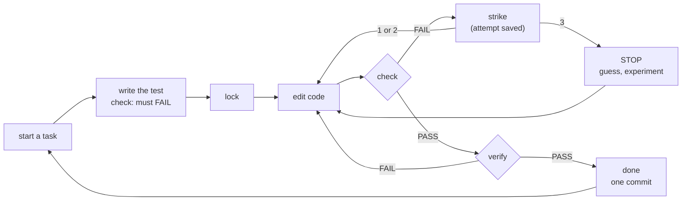

# How Sci-Harness works

The [README](../README.md) says what Sci-Harness does for you. This guide shows how it does it: the rules the
agent works under, and the full reference.

**Contents:** [How it works](#how-it-works) · [Built for real projects](#built-for-real-projects) · [FAQ](#faq) ·
[Reference](#reference)

The skill is called `sci`. Your agent runs its tool, `.sci/sci`, in your repository; you never need to.
[`SKILL.md`](../SKILL.md) is what the agent reads.

## How it works

| Part | Its job |
| --- | --- |
| **Notebook** · `.sci/` | The goal, the tasks, every result, every ruled-out cause. Survives any compaction. |
| **Referee** · `.sci/sci` | Runs your tests, refuses shortcuts and ends every answer with one `NEXT:` step. |
| **Rulebook** · [`SKILL.md`](../SKILL.md) | Trust the referee over memory, never weaken a test, stop guessing after 3 misses. |



sci never edits your code. It checks, records and, when asked, undoes; every attempt is saved as a patch first.

<details>
<summary><b>The rules in detail</b></summary>

| Rule | What it means |
| --- | --- |
| **Test first** | For new behavior the first `check` must FAIL. For a refactor it must PASS. |
| **Lock** | `lock` records the acceptance tests (in Rust, just the tests inside a source file). Any change to them fails every check. A test that must follow an intended change is freed with `unlock --reason`, and the reason goes on your review list. |
| **Guard** | Every check also confirms that no finished task's test changed and no test was weakened: a new skip or `#[ignore]`, a deleted assert, `assert True`, a looser tolerance, a changed expected number. |
| **Strikes** | A failed check after a code change, once the test is locked. Reruns of unchanged code and guard-only failures are not strikes. |
| **STOP** | After 3 strikes the agent writes at least 2 hypotheses and runs an experiment through sci before it may edit code. After 6, it starts over a different way or asks you. Ruled-out causes stay listed for later tasks. Code changed while STOP is on is not blocked, but `report` counts it for you. |
| **Hand edits** | `.sci/state.json` and `.sci/config.json` change only through sci commands. When either was edited by hand, sci warns and puts the changed fields (`T2.strikes`, `ignore_globs`) on your review list. |
| **Verify** | The guard, the build, this task's test, every finished task's test, saved reference outputs and your whole suite. Only failures that are not in the baseline count. Steps that passed on identical code are reused. |
| **Rerun what failed** | After a failed verify, `check` reruns just the failing tests (pytest, unittest, cargo, jest, vitest, `node --test`). |
| **Done** | Commits only the task's files, as `[T1]`, after a verify on the current files. Comment or doc edits after verify are fine. |
| **Long runs** | Commands keep running in the background; `.sci/sci wait` collects them, so a tool timeout or a new session loses nothing. |

</details>

## Built for real projects

- **Rust, Python, JavaScript/TypeScript first.** Rust unit tests inside `src/*.rs` are locked on their own, so
  the code around them stays editable. jest, vitest and `node --test` failures are read per test. Python test
  code is checked for early returns, swallowed asserts and dead branches.
- **Any language with a test command.** Failing tests are read from pytest, unittest, cargo, nextest, go,
  ctest, jest, vitest, TAP, Maven, Gradle, dotnet, RSpec and PHPUnit.
- **Already-failing tests are fine.** `baseline` records them; only new failures count.
- **Big repositories.** About 0.6 s of overhead per check on 60,000 files.
- **Slow suites.** Runs continue in the background, and nothing that passed on identical code runs twice.
- **Small models.** One clear `NEXT:` step after every command, so a small model always knows what to do.

## FAQ

<details>
<summary><b>Will it slow my agent down?</b></summary>

Rarely. A check runs only the task's own test, plus whatever the last verify failed on. Passing steps on
unchanged code are reused, a test can be unlocked for an intended change at no strike, and edits to docs or
comments after a verify need no new one.

</details>

<details>
<summary><b>My project already has failing tests. Can I use it?</b></summary>

Yes. `baseline` records the failures that exist before the work starts. `verify` fails only on new ones.

</details>

<details>
<summary><b>Is it only for small models?</b></summary>

No. Small models gain the most because they lose the plan soonest, but every model drifts on a long enough task.

</details>

<details>
<summary><b>Is it only for scientific code?</b></summary>

No. It is a software-engineering skill: features, bug fixes, refactors, migrations and performance work. For
numerical code it adds saved reference outputs and a convergence-order check, which stay out of the way
otherwise.

</details>

<details>
<summary><b>Does anything leave my machine?</b></summary>

No. sci is a local script with no network access. Only the installer downloads this repository from GitHub.

</details>

<details>
<summary><b>What does it do with git?</b></summary>

When a task is done, sci commits that task's files (`.sci/sci config set commit false` writes a patch instead).
Restore points live under `refs/sci/`. sci never pushes.

</details>

<details>
<summary><b>What do I do while it works?</b></summary>

Nothing, unless it asks. When a requirement is unclear, the agent parks that task with a question and carries
on with the others. At the end it gives you the report.

</details>

<details>
<summary><b>How do I update or uninstall?</b></summary>

Run the install command again, then restart your agent. Each project keeps its own copy of the tool in `.sci/`;
`.sci/sci resume` says when a newer one is installed, and
`python3 ~/.local/share/agent-skills/sci/scripts/sci.py init` updates it with the plan kept. To remove
everything, run the installer with `--uninstall`.

</details>

## Reference

<details>
<summary><b>Commands</b></summary>

Your agent runs these from the repository root as `.sci/sci <command>`; `.sci/sci help` lists every option.

| Command | What it does |
| --- | --- |
| `resume` | the goal, the tasks, the active task, ruled-out causes, notes and `NEXT:` |
| `init --objective "..."` | sets up `.sci/` (run once, as `python3 <skill folder>/scripts/sci.py init`) |
| `task add "title" --verify "cmd" --scope PATH` | adds a task; `--inv`, `--dep` and `--why` add invariants, dependencies and context |
| `task start [ID]`, `task block ID --reason "..."`, `task scope GLOB` | starts a task; parks one with a question; widens its files |
| `map`, `find NAME` | a repository overview; definitions and uses of a name |
| `note "fact" --kind code`, `now "..."` | saves what the agent learned; what it is doing right now |
| `check` | runs the task's test and what the last verify failed on; counts strikes |
| `lock`, `unlock FILE --reason "..."` | freezes the acceptance tests; frees one, for your review |
| `verify` | the full gate (`--quick`: guard, build and the task's test; `--fresh`: reuse nothing) |
| `done -m "summary"` | commits the task's files and protects its tests |
| `restore` | undoes to the last PASS, `--to start`, or `--paths FILE` |
| `run "cmd"`, `hyp add/refute/confirm` | an experiment logged as evidence; a guess and its verdict |
| `wait`, `cancel` | collects or stops a background run |
| `golden add NAME --cmd "cmd"`, `order` | saved reference outputs; convergence order of numerical code |
| `baseline` | records which tests fail before the work starts |
| `out RUN --grep PATTERN`, `log` | reads a saved log; recent events |
| `review`, `report` | what needs your review; the final summary |
| `pause`, `unpause`, `config` | switches sci off and on; shows or changes settings |

</details>

<details>
<summary><b>Settings</b></summary>

`.sci/sci config` shows them; `config set KEY VALUE`, `config add` and `config remove` change them.

| Setting | Default | What it does |
| --- | --- | --- |
| `test_cmd` | detected by `init` | the project's test command |
| `regress_cmd` | set by `baseline` | the suite that `verify` reruns |
| `build_cmd` | none | rebuilds when a file matching `build_globs` changes (e.g. `maturin develop`) |
| `background`, `wait_secs` | `true`, `100` | background runs; seconds before `STILL RUNNING` |
| `check_timeout`, `verify_timeout` | `900`, `3600` | seconds before a run is stopped |
| `commit` | `true` | `done` commits; `false` writes a patch instead |
| `shell` | bash (Git Bash on Windows) | the shell for task commands: a path, `cmd`, `powershell` or `pwsh` |
| `test_globs`, `doc_globs`, `build_globs`, `ignore_globs` | many | which files are tests, docs and build inputs, and which sci ignores |
| `autopilot` | `false` | with the Antigravity hooks, asks the agent to continue while tasks remain |

</details>

<a id="install-options"></a>
<details>
<summary><b>Install options</b></summary>

**Command Prompt:**

```bat
curl -fsSLo %TEMP%\sci.ps1 https://raw.githubusercontent.com/Nag681/sci-harness/main/install.ps1 && powershell -NoProfile -ExecutionPolicy Bypass -File %TEMP%\sci.ps1
```

| Option | Effect |
| --- | --- |
| `--hooks` | adds the [optional hooks](#optional-hooks) (each config file is backed up first) |
| `--remove-hooks` | removes the hooks and keeps the skill |
| `--status` | shows what is installed where |
| `--uninstall` | removes everything the installer added |
| `--only claude,codex` | installs for these agents only |
| `--copy` | copies instead of linking |
| `--project <repo>` | puts the skill into a repository for the whole team |
| `--target <dir>` | also installs into another skills folder |
| `--dry-run` | shows the changes and makes none |

```bash
curl -fsSL https://raw.githubusercontent.com/Nag681/sci-harness/main/install.sh | sh -s -- --hooks
```

```powershell
$env:SCI_ARGS = "--hooks"; irm https://raw.githubusercontent.com/Nag681/sci-harness/main/install.ps1 | iex
```

In the Command Prompt, add options after `%TEMP%\sci.ps1`. To install a tagged version, set `SCI_REF` to one of
the [tags](https://github.com/Nag681/sci-harness/tags). From a clone: `python3 install.py <options>`.

</details>

<details>
<summary><b>Where it installs</b></summary>

The skill lives in `~/.local/share/agent-skills/sci`, and each agent gets a link to it:

| Agent | Skill folder | Hooks (optional) |
| --- | --- | --- |
| Claude Code | `~/.claude/skills/` | `~/.claude/settings.json` |
| Codex CLI | `~/.agents/skills/` | `~/.codex/hooks.json` ¹ |
| Gemini CLI | `~/.agents/skills/` | `~/.gemini/settings.json` |
| Antigravity | `~/.gemini/config/plugins/sci/` | the plugin's `hooks.json` |
| OpenCode | `~/.agents/skills/` | the plugin `~/.config/opencode/plugins/sci.js` ² |
| pi | `~/.agents/skills/` | |
| anything else | `--target <dir>` | |

Anything in the way that the installer did not put there is moved to `~/.local/share/agent-skills/backups/`,
never deleted. Restart running agents after installing.

¹ Current Codex runs hooks unless its `config.toml` has `[features] hooks = false`; older versions need `hooks = true` there.

² OpenCode has plugins instead of hook commands. The plugin file imports `scripts/opencode_plugin.mjs` from the
installed skill, which works with OpenCode 1.18.29 and newer, including 2.x. Restart OpenCode (on 2.x:
`opencode service restart`) after turning the hooks on or off.

</details>

<a id="optional-hooks"></a>
<details>
<summary><b>Optional hooks</b></summary>

Off unless you install with `--hooks`, and inactive outside repositories that use sci.

| When | What happens |
| --- | --- |
| a session starts, or (Claude Code, Antigravity) the context was summarized | the agent is told where the plan is and what to do next |
| every model request (OpenCode) | the same briefing is part of the system prompt, so compaction cannot drop it |
| each message you send (Antigravity: each step) | a one-line reminder: goal, progress, active task, last check, next step |
| before a shell command | commands that destroy work, such as `git reset --hard` and `git clean`, are blocked (the agent is told why and what to use instead) |
| Antigravity stops | with `autopilot` on, the agent is asked to continue while tasks remain |

The hooks never approve anything on their own; your agent's permission settings still apply.

</details>

<details>
<summary><b>What's in <code>.sci/</code></b></summary>

| Path | Holds |
| --- | --- |
| `sci`, `sci.py` | the referee, copied in by `init` |
| `state.json`, `config.json` | the plan (goal, tasks, locks, guesses, notes) and the settings |
| `HANDOFF.md` | a readable summary, rewritten after every change |
| `events.jsonl` | a diary of everything that happened |
| `runs/`, `jobs/` | the full output of every command; background runs |
| `attempts/` | failed and undone attempts, as patches |
| `golden/`, `scratch/` | saved reference outputs; the agent's experiments |

`.sci/` is listed in `.git/info/exclude`, so it is never committed, and a backup of the plan lives inside
`.git/`.

</details>

<details>
<summary><b>Windows notes</b></summary>

- Install Python from python.org or with `winget install Python.Python.3.12`.
- Without Developer Mode, agents get copies instead of links; run the installer again after updating.
- Check and verify commands run in Git Bash, so use forward slashes (`tests/test_x.py`), or
  `.sci/sci config set shell pwsh`.
- The tool is `.sci/sci` in PowerShell and Git Bash, `.sci\sci` in the Command Prompt.

</details>

<details>
<summary><b>Development</b></summary>

```bash
python3 -m unittest discover -s tests
python3 .github/readme/build.py   # redraws the README pictures
```

CI runs the tests on Linux, macOS and Windows and the install commands on every push. `SCI_SOURCE=<folder or
archive>` makes the installers work offline. Changes are listed in [CHANGELOG.md](../CHANGELOG.md).

</details>
